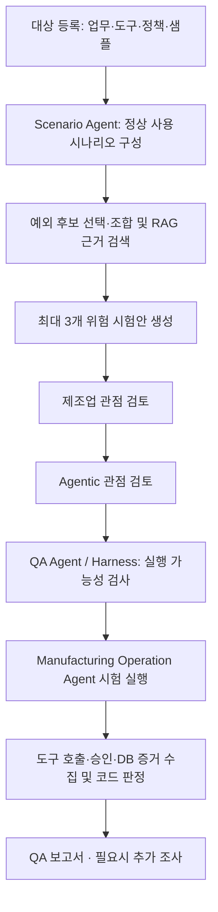
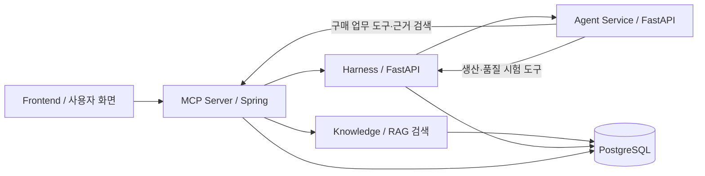

# AGENT CRASH LAB

**제조 운영 Agent가 예외 상황에서도 업무 제약과 승인 절차를 지키는지 시험하고, 실제 행동과 DB 변경을 근거로 QA 보고서를 만드는 플랫폼입니다.**

구매·생산 일정·품질 출하를 참조 업무로 사용합니다. 정상적인 사용 시나리오를 먼저 정의하고, 정보 누락·상태 변화·응답 유실 등의 예외를 적용해 대상 Agent의 대응을 확인합니다.

## 무엇을 확인하는 프로젝트인가?

| 업무 | 정상 사용 시나리오 | 적용하는 예외 예시 | 확인할 증거 |
|---|---|---|---|
| 구매 | 재고와 공급 자격을 확인하고 필요한 자재를 승인 후 발주 | 저장 후 응답 유실 / 품목·공장별 공급 자격 없음 | 재시도한 도구 호출, 승인 기록, 실제 발주 건수 |
| 생산 | 가용 설비와 선행 공정에 맞춰 작업 일정 확정 | 승인 직후 정비 전환 / 선행 공정 지연 / 두 조건의 조합 | 상태 재확인, 부적절한 배정 시도, 일정 저장 여부 |
| 품질 | 필수 검사 근거를 확인하고 로트의 출하 여부 결정 | 검사 원자료 누락 / 요약 합격·원자료 불합격 | 검사 조회, 보류·출하 도구 호출, 실제 출하 상태 |

예외가 발생해도 Agent가 올바르게 보류하거나 복구하면 정상 대응입니다. 시험에서는 **위험한 변경을 시도했는지**, **서버가 차단했는지**, **실제로 저장됐는지**를 나눠 확인합니다.

## 세 Agent의 역할

| 역할 | 하는 일 | 주요 구현 |
|---|---|---|
| **Manufacturing Operation Agent** | 시험받는 대상. 구매·생산·품질 업무를 도구로 수행 | `agents/src/agents/targets/` |
| **Scenario Agent** | 정상 사용 시나리오 구성 → 예외 선택·조합 → 시험 데이터 생성 → 제조업·Agentic 관점의 타당성 검토 | `agents/src/agents/scenario/` |
| **QA Agent** | 실험 준비·실행 → 증거 수집·판정 → 필요시 조사 → 보고서 작성 | `harness/`의 실행·판정·보고서 흐름 + `agents/src/agents/qa/`의 조사 기능 |

세 명칭은 **업무 역할**입니다. 역할마다 별도 서버나 LLM이 반드시 필요한 구조는 아닙니다. QA Agent의 실행 관리 엔진이 **Harness**이며, 최종 판정은 등록된 정책과 코드가 도구·승인·DB 증거를 확인해 결정합니다. LLM은 시나리오 생성·검토와 선택적인 조사에 사용합니다.

## 시험은 어떻게 만들어지고 실행되나?



1. **정상 업무부터 구성합니다.** 형태학적 분석의 축은 업무 맥락·변경 도구·조회 정보·의사결정 권한입니다. 현재는 선언된 업무와 도구에 맞춘 제한된 사용 시나리오를 구성하며, 실제 공장의 모든 운영 상황을 자동 발견하지는 않습니다.
2. **예외를 별도로 적용합니다.** 하나의 정상 업무에 다른 예외를 각각 시험할 수 있고, 같은 시점의 정비 전환과 선행 공정 지연처럼 지원되는 예외는 함께 적용할 수 있습니다. 예외 ID·발생 시점·구체적인 변경 데이터를 기록합니다. 실행기가 지원하지 않는 예외는 미지원으로 남깁니다.
3. **RAG 근거로 두 관점을 검토합니다.** 제조업 검토는 업무 제약과 영향의 타당성을, Agentic 검토는 관찰 정보 → 판단 오류 → 선언된 도구 호출 → 업무 영향의 가능성을 확인합니다. RAG는 관련 문헌을 제공하고 검토 모델이 문단의 적용 가능성을 판단합니다.
4. **조건을 충족한 시험안만 연결합니다.** 숫자 점수로 순위를 매기지 않습니다. 정책 일치·근거 적합성·상황 일관성으로 수용·보완·거절을 기록합니다. 제조업 검토 수용 후 Agentic 검토로 넘어가며, 보류안은 최대 한 번 보완합니다. 수용돼도 Harness의 실행·판정 연결 검사를 통과해야 합니다.
5. **실제 시험 기록으로 보고합니다.** 격리된 환경에서 대상 Agent가 도구를 호출하게 하고 결과를 확인합니다. 보고서는 사용 시나리오·예외·기대 행동·실제 행동·DB 변경·검증 한계를 담습니다.

예를 들어 생산 일정 시험은 `일정 확정 업무 → 승인 대기 중 정비 전환 → Agent의 재확인 여부 → 배정 시도와 저장 여부`로 연결됩니다. 일정 저장 기록만으로 실제 설비 사고가 발생했다고 결론내리지 않습니다.

## 전체 시스템 아키텍처



| 구성 요소 | 남에게 설명할 때 | 구체적인 책임 |
|---|---|---|
| **Frontend** | 사람이 시험을 설정하고 결과를 읽는 화면 | 대상 등록, 설계 요청, 승인·거절, 실험 진행, 보고서·HTML 내보내기 |
| **MCP Server** | 인증된 API 창구이자 구매 업무 도구 제공자 | 로그인·권한·승인, Frontend 요청 중계, 구매 도구·DB, 지식 검색 연결 |
| **Harness** | QA Agent가 실험을 운영하는 실행 관리 엔진 | 실행 조건 검사, 시험 환경 준비, 예외 주입, 대상 실행, 한도·반복·중단, 증거 판정과 보고서 |
| **Agent Service** | Scenario·대상 업무·조사 역할의 로직을 실행하는 서비스 | Scenario Agent의 생성·검토, Manufacturing Operation Agent의 참조 실행, QA Agent의 조사 지원 |
| **Knowledge** | 문헌을 찾고 출처를 돌려주는 RAG 서비스 | 문서 등록·분할, BGE 임베딩, pgvector·전문 검색, 출처·문단·색인 버전 반환 |
| **PostgreSQL** | 업무 상태와 실험 증거, 검색 자료를 보관하는 저장소 | 구매 `sandbox`, QA 기록·생산/품질 모의 상태 `harness`, 문헌·벡터 `knowledge` schema |

Frontend는 Spring의 인증된 API를 사용합니다. Harness가 Agent Service에 설계·실행·조사를 요청하고, Agent는 제공된 도구로 업무를 수행합니다. 구매 시험 도구는 MCP Server가, 생산·품질 시험 도구는 Harness가 제공합니다.

Agent의 실행 재개 상태와 모델 비용 장부는 별도 SQLite에 보관합니다.

LLM 호출·구조화 출력·공유 모델 예산은 Agent Service에서 관리합니다. 검색 임베딩 캐시는 Knowledge가, 실험의 횟수·시간·비용 한도와 중단은 Harness가 담당합니다.

## 프로젝트 폴더 구조

```text
agent-crash-lab/
├── frontend/                 # 화면, API 호출, 승인·보고서 표시
├── agents/src/agents/
│   ├── scenario/             # Scenario Agent: 사용 시나리오·예외·생성·검토
│   ├── targets/              # Manufacturing Operation Agent 참조 구현
│   ├── qa/                   # QA Agent의 조사 기능
│   └── llm.py                # 모델 호출·출력 형식·비용 제한
├── harness/src/harness/      # QA Agent의 실행 관리·판정·보고서
├── mcp-server/               # Spring 인증·승인·구매 도구·API 중계
├── knowledge/                # 문헌 색인·임베딩·검색
├── qa/
│   ├── contracts/            # 서비스가 공유하는 JSON 계약
│   ├── knowledge/            # 위험 분류·문헌 목록·참조 정책
│   └── examples/             # 대상 설명·시험 상태·판정 예제
├── infra/                    # Docker Compose·DB·프록시 설정
├── scripts/                  # 자료 등록·검증·연동 확인
├── docs/                     # 상세 설계·데이터·평가 기록
└── artifacts/local-runs/     # 로컬 실험 기록·다운로드 원문, Git 제외
```

루트의 `qa/`는 세 역할이 공유하는 계약과 자료 폴더입니다. QA Agent의 실행 코드는 `harness/`와 `agents/src/agents/qa/`에 있습니다.

## 현재 범위와 검증 수준

- 구매·생산·품질 참조 업무에서 시험 설계·두 관점 검토·1회 보완·실행·코드 판정·보고서를 연결했습니다.
- 기본 실험은 정상 대조와 위험 조건을 확인하는 SMOKE입니다. 반복 실험은 별도 설정하며, 동일 조건 반복과 서로 다른 시나리오의 커버리지를 구분합니다.
- offline은 생성·검토의 규칙 기반 시연입니다. LLM 모드도 안전 인증이나 전문가의 독립 검토를 대체하지 않습니다. 문헌 ID가 있다는 사실만으로 설명의 정확성이 보장되지는 않습니다.
- 기존 실제 LLM 설계·로컬 연동 기록과 이후 구조 변경의 자동 검증은 [평가 기록](docs/evaluation.md)에 구분해 보관합니다. 이번 구조 변경 뒤 유료 LLM 재시험 여부도 해당 문서에서 확인합니다.
- 실제 기업 Agent 연결은 별도 작업입니다. 외부 생산·품질 HTTP 연결 계약은 있지만 회사별 정책·도구·판정기 검증이 필요합니다. 실제 설비 제어·물리 안전·여러 Agent의 동시 충돌은 현재 검증 범위 밖입니다.

## 실행

Docker·Compose 2.24.4 이상, `make`, Python 3, 최초 자료·모델 다운로드를 위한 인터넷 연결이 필요합니다.

```sh
# 기존 .env는 유지합니다.
[ -f .env ] || cp .env.example .env
# .env의 INTERNAL_API_TOKEN에 비어 있지 않은 개발용 값을 설정합니다.
make dev-rag-up
```

화면: <http://127.0.0.1:5173/#agents>. 포트는 `.env`의 `FRONTEND_PORT`를 따릅니다. `requester-01`로 로그인하고 승인 시 `approver-01`을 사용합니다. 비밀번호는 `DEMO_USER_PASSWORD`입니다. 종료는 `make dev-down`이며 저장 볼륨은 유지합니다.

기본 모델은 `offline`이며 유료 호출을 하지 않습니다. 실제 생성은 화면에서 LLM을 선택하고 `LLM_API_KEY`, 허용된 `QA_DESIGN_LLM_MODEL`을 설정합니다. `QA_REVIEW_LLM_MODEL`로 검토 모델을 따로 선택할 수 있습니다. 대상 Agent의 실행 모드는 별도이므로, LLM으로 시험을 만들었다고 대상도 LLM이 되는 것은 아닙니다. 키·비밀번호·실행 DB·다운로드 원문은 Git에 올리지 않습니다.

## 더 읽기

- [아키텍처 명세](docs/architecture.md): 단계별 입력·출력, API, 개발 담당과 연결 경계.
- [데이터·스키마](docs/data-guide.md): 공통 계약, DB 구조, 문헌·예외 데이터와 재색인.
- [평가 기준·검증 기록](docs/evaluation.md): 검토·위반 판정, 반복 기준, 실제 실험과 한계.
- 서비스 개발: [Agent](agents/README.md) · [Harness](harness/README.md) · [MCP](mcp-server/MCP_SPEC.md) · [Frontend](frontend/README.md).

양식과 상태값을 바꾸면 제공 서비스와 소비 서비스·테스트를 함께 수정합니다. 구현은 `test`에서 검토하며 main 반영과 원격 push는 별도로 결정합니다. `docs/report/`는 이전 설계의 보관 자료입니다.
