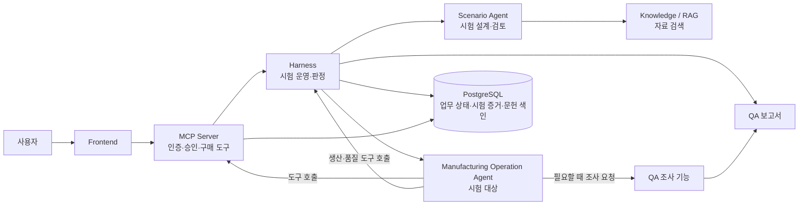
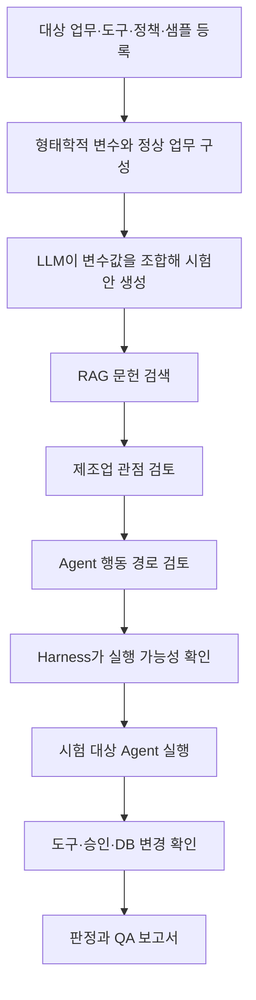

# OOPS! (Operational Oversight & Proof System)

> **"앗!(Oops!) 하는 순간을 사전에 포착하는 운영 감시 및 증적 검증 시스템"**

제조 운영 Agent가 예외 상황에서도 업무 제약과 승인 절차를 지키는지 시험하고, **도구 호출·승인·DB 변경 기록**으로 QA 보고서를 만드는 플랫폼입니다. 제조 운영에 자율 Agent를 연결할 때 생길 수 있는 운영·재무·사이버-물리 위험을 사전에 살피는 것이 목표입니다.

구매·생산 일정·품질 출하 Agent는 시험용 참조 예시입니다. 현재 예시는 프로젝트가 만든 합성 Agent와 가상 상태이며, 실제 기업 Agent나 공장에 연결되어 있지 않습니다.

## 한눈에 보기



| 이름 | 쉽게 말하면 | 맡은 일 |
|---|---|---|
| **Manufacturing Operation Agent** | 시험받는 Agent | 구매·생산·품질 업무를 수행하고 도구를 호출 |
| **Scenario Agent** | 시험안을 만드는 역할 | GMA에서 영감을 받은 형태학적 분석으로 정상 업무를 구조화하고, 예외를 조합해 제조업·에이전틱 두 관점에서 검토 |
| **Harness** | 시험 진행·기록 시스템 | 시험 가능성 확인, 상태 준비, 실행·중단·증거 수집, 코드 판정, 보고서 작성 |
| **QA Agent** | QA 업무 역할 | Harness가 시험을 관리하고, 별도 조사 기능이 필요할 때 실행 기록을 분석 |

세 역할은 책임을 구분한 이름입니다. 각각 독립 서버나 독립 LLM을 뜻하지 않습니다. Harness는 QA Agent의 실행 관리 엔진입니다.

## 시험은 이렇게 진행됩니다



1. **정상 업무와 조건 축을 정합니다.** GMA(General Morphological Analysis)에서 영감을 받은 형태학적 분석이 업무, 설비·정보 조건, 도구와 권한을 구조화합니다.
2. **LLM이 조합을 구체적인 시험안으로 만듭니다.** 예를 들어 설비 상태·선행 공정·기존 일정의 값을 조합하고, 새 요청값과 상태 변경, 관찰 정보, 시험할 도구 행동을 작성합니다. 변수·값·도구·정책·시뮬레이터 지원 범위 밖의 내용을 발명할 수는 없습니다. 예외가 곧 Agent 실패라는 뜻은 아닙니다.
3. **두 관점으로 검토합니다.** 제조업 검토는 제약과 업무 영향이 타당한지, 에이전틱 검토는 관찰 정보에서 판단 오류와 도구 호출로 이어지는 경로가 가능한지 살핍니다. RAG는 각 검토에 참고 문헌을 제공합니다. 현재는 Scenario Agent 내부의 순차 검토 단계이며, 서로 독립된 평가자나 MAST 채점기를 뜻하지 않습니다.
4. **Harness가 시험을 실행하고 판정합니다.** 모델의 설명만으로 합격시키지 않고 도구 호출, 승인 기록, 실제 저장 상태를 등록된 코드와 정책으로 확인합니다. 현재 시뮬레이터는 격리된 업무 상태를 다루며 SimPy 기반 공장 모델이나 물리 설비를 구동하지 않습니다.

## 시스템 구성

| 구성 요소 | 역할 | 코드·자료 위치 |
|---|---|---|
| Frontend | 대상 선택, 시험안 확인, 승인, 진행·보고서 화면 | `frontend/` |
| MCP Server | 로그인·권한·승인, 공개 API, 구매 업무 도구 | `mcp-server/` |
| Harness | 시험 설계 연결, 실행·예외 주입, 판정·보고서 | `harness/` |
| Agent Service | Scenario Agent, 참조 대상 Agent, QA 조사 기능 | `agents/src/agents/` |
| Knowledge | 문헌 분할·임베딩·검색과 출처 반환 | `knowledge/` |
| PostgreSQL | 업무 상태·시험 기록·문헌 색인 저장 | `infra/`, 서비스별 DB schema |
| QA 자료 | 공통 계약, 지식, 대상·시험 예시 | `qa/` |

구매 도구는 MCP Server가 제공합니다. 생산·품질의 시험 도구와 가상 상태는 Harness가 제공합니다. 실제 기업 Agent를 연결하려면 회사별 도구·정책·판정 연결을 따로 구성해야 합니다.

## 저장소 안내

```text
frontend/             사용자 화면
mcp-server/           인증 API, 승인, 구매 도구
harness/              시험 실행·코드 판정·보고서
agents/src/agents/
  scenario/           Scenario Agent
  targets/            구매·생산·품질 참조 대상 Agent
  qa/                 QA 조사 기능
knowledge/            RAG 색인·검색 서비스
qa/contracts/         서비스 간 데이터 형식
qa/knowledge/         검색 문헌·위험 분류·정책·가이드
qa/examples/          대상과 시험 입력·판정 사례
qa/reference/         외부 공개 자료 표본
config/               실행 설정
infra/                Docker·DB 설정
docs/                 아키텍처·데이터·평가 설명
artifacts/local-runs/ 로컬 실험 자료, Git 제외
```

`frontend/dist/`는 이 프로젝트에서 직접 관리하고 제공하는 화면 코드입니다. 이름과 달리 정리 대상 빌드 출력물이 아닙니다. 반면 `.pytest_cache`, `__pycache__`, `.gradle`, `build` 등은 로컬에서 다시 만들 수 있는 도구 산출물이며 Git 추적 대상이 아닙니다.

## 현재 범위

- 시험은 격리된 참조 환경과 가상 업무 상태에서 실행합니다.
- LLM 모드는 형태학적 조건과 예외 카탈로그를 바탕으로 새 시험 상황과 구체적인 입력·상태 변경값을 작성합니다. 코드는 조합·스키마·실행 지원을 검사합니다. 기본 offline 모드는 규칙 기반 시연이며, 형태학적 분석은 가능한 모든 현장 조건을 전수 생성하거나 완전성을 증명하지 않습니다.
- B1 참조 실행에는 승인·설비·공정·검사 제약을 막는 코드 규칙이 있습니다. 이는 가상 시험 환경의 방어 규칙이며 실제 공장의 독립 안전 인터록은 아닙니다.
- 판정은 등록된 코드·정책으로 도구 시도와 DB 반영을 구분합니다.
- 문헌 검토는 시험안의 근거를 보완합니다. 문헌이 있다는 사실이나 두 단계의 LLM 검토만으로 안전성이 증명되지는 않습니다.
- 보류안은 제한적으로 한 차례 보완할 수 있지만, 결과가 다음 세대 시나리오나 운영 가드레일을 자동 변경하지는 않습니다.
- 실제 설비 제어, 물리 안전 인증, 여러 Agent의 동시 충돌은 현재 범위 밖입니다.
- 기본 모드는 offline이며 유료 LLM 호출을 하지 않습니다.

## 실행

Docker Compose와 `make`가 필요합니다. 기존 `.env` 파일은 덮어쓰지 마세요.

```sh
[ -f .env ] || cp .env.example .env
```

`.env`에서 `INTERNAL_API_TOKEN`을 설정한 뒤:

```sh
make dev-rag-up
```

화면은 <http://127.0.0.1:5173/#agents>에서 엽니다. 종료는 `make dev-down`입니다. 기본 offline 모드에서는 유료 LLM을 호출하지 않습니다.

## 더 읽기

- [시스템 아키텍처와 단계별 계약](docs/architecture.md)
- [데이터·문헌·DB 안내](docs/data-guide.md)
- [대상 Agent와 근거 데이터 설계](docs/scenario-data-design.md)
- [형태학적 변수·조합·문헌 근거](docs/morphological-scenario-design.md)
- [형태학적 분석 쉬운 예시와 발표 대본](docs/morphological-analysis-for-presentation.md)
- [구매·생산·품질 Harness 공통화 점검](docs/harness-data-driven-review.md)
- [참조 Agent 예시와 자료 출처](qa/examples/README.md)
- [평가 기준과 실험 기록](docs/evaluation.md)
- 개발 안내: [Frontend](frontend/README.md) · [Harness](harness/README.md) · [Agent](agents/README.md) · [MCP](mcp-server/MCP_SPEC.md)
