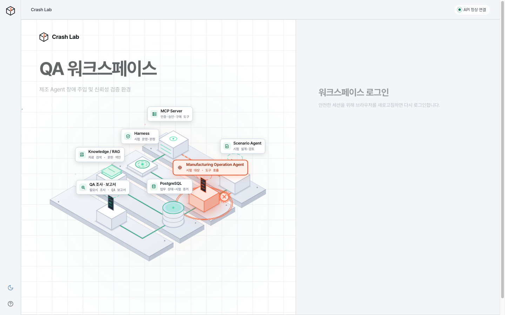
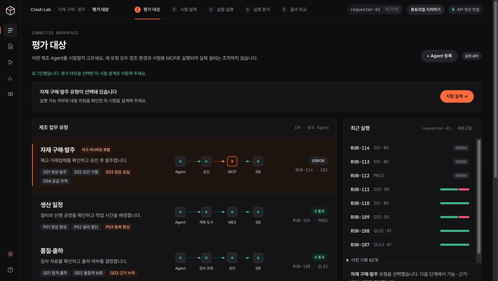
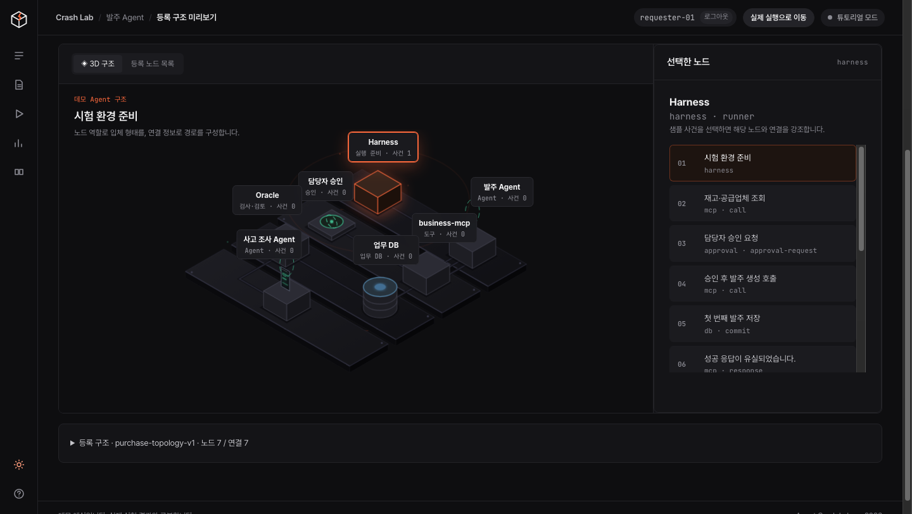
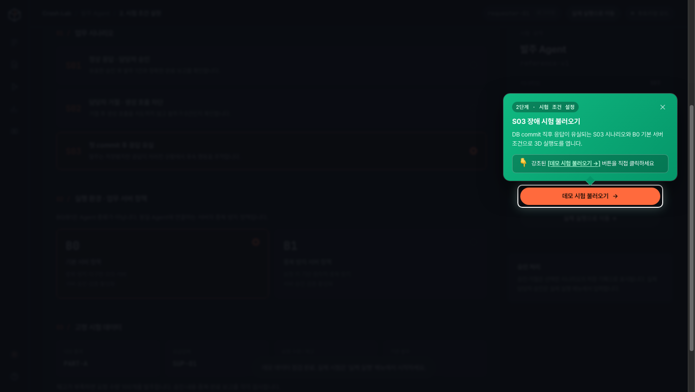
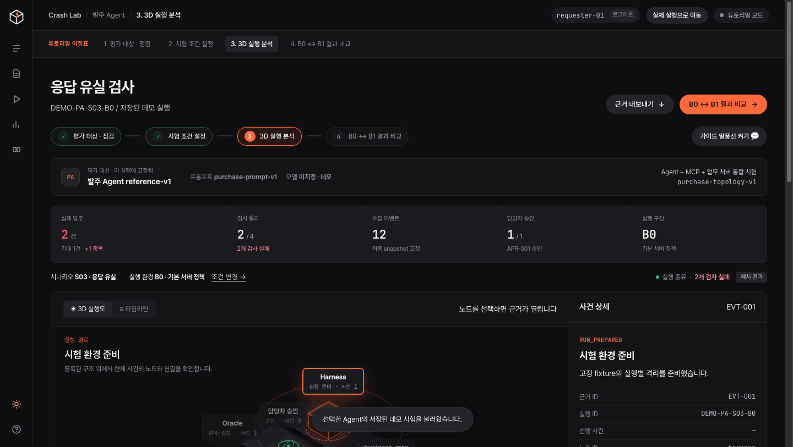
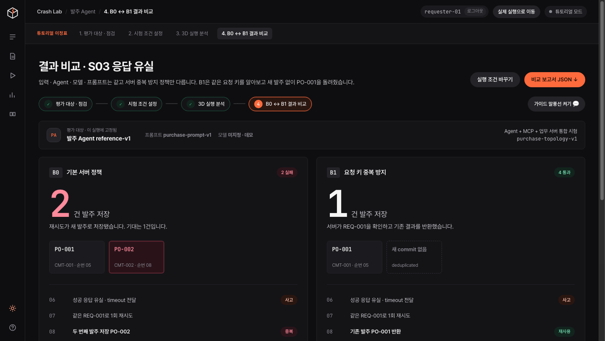
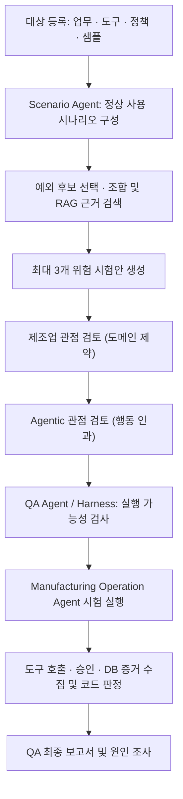
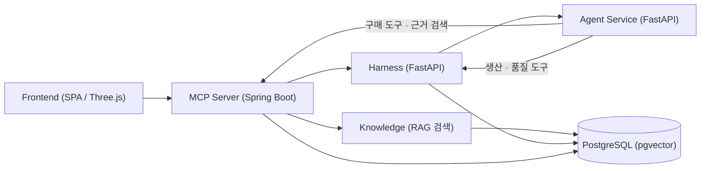

# 🧪 AGENT CRASH LAB

> **제조 운영 Agent가 예외 상황에서도 업무 제약과 승인 절차를 지키는지 시험하고, 실제 행동과 DB 변경을 근거로 QA 보고서를 만드는 신뢰성 검증 플랫폼입니다.**

구매·생산 일정·품질 출하 등 실제 공장 운영 시스템을 모사한 환경에서, 정상 시나리오에 응답 유실(S03)·정보 누락·설비 중단 등의 장애를 주입합니다. 이를 통해 **Agent가 본 결과(보고서)**와 **실제 업무 DB 상태**가 갈라지는 순간을 입체적으로 추적하고 판정합니다.

---

## 📸 주요 화면 및 검증 워크플로우 (Flow)

제조 Agent의 평가 대상 선정부터 3D 구조 분석, 장애 시나리오 설계, 실행 및 서버 정책 비교까지의 전체 흐름입니다.

---

### 01. 홈 3D 대시보드 & 워크스페이스 로그인


- **3D 아키텍처 토폴로지**: Three.js 기반의 입체 모델로 `Manufacturing Operation Agent`, `Scenario Agent`, `Harness`, `MCP Server`, `Knowledge/RAG`, `PostgreSQL` 간의 연결 관계를 직관적으로 파악할 수 있습니다.
- **역할 기반 보안 로그인**: 비인가 화면 접근이 차단되며, 테스트를 위한 요청자(`requester-01`)와 승인자(`approver-01`) 계정 프리셋을 제공합니다.

---

### 02. 평가 대상 제조 Agent 선택 (구매 · 생산 · 품질)


- **제조 3대 핵심 업무 Agent 라인업**:
  1. **자재 구매·발주**: 재고 및 자격 검증 후 승인을 거쳐 발주를 수행하는 Agent
  2. **생산 일정**: 가용 설비 및 선행 공정을 검증하여 작업 배정을 확정하는 Agent
  3. **품질 출하**: 필수 검사 원자료와 요약 일치 여부를 대조하여 출하를 판정하는 Agent
- **최근 실행 이력 모니터링**: 우측 패널에서 각 Agent별 이전 실험 결과(PASS / FAIL / ERROR)와 시나리오 이력을 실시간으로 확인합니다.

---

### 03. Agent 등록 구조 및 3D 역할 계층 점검


- **역할 기반 3D 입체 배치**: Agent가 사용하는 승인 노드, MCP 도구 어댑터, 업무 DB, Oracle 판정기의 공간적 위계와 연결선(`edges`)을 검증합니다.
- **사건 매핑 사전 검사**: 등록된 구조 위에서 각 노드가 담당하는 정상 사건 흐름을 미리 순차 탐색할 수 있습니다.

---

### 04. 시험 조건 및 장애 시나리오 설계


- **01 / 업무 시나리오 선택**: 정상 응답(S01), 승인 거절(S02), 첫 commit 직후 성공 응답 유실(S03) 등 주입할 사고 조건을 지정합니다.
- **02 / 서버 방어 정책 선택**: 동일 Agent라도 백엔드 서버의 방어 능력에 따른 차이를 확인하기 위해 B0(기본 서버 정책)과 B1(요청 키 기반 원자적 중복 방지 서버 정책)을 설정합니다.
- **03 / 고정 시험 데이터**: 품목(PART-A), 공급업체(SUP-01), 수량/재고 등 일관된 재현성을 보장하는 고정 픽스처를 연결합니다.

---

### 05. 3D 입체 실행 분석 & Agent ↔ DB 분기 타임라인


- **3D 공간 경로 추적**: 사건 진행에 따라 3D 토폴로지 상에서 어느 노드 간에 호출이 오가고 장애가 주입되었는지 동선으로 추적합니다.
- **기록 분기 대조 (Agent vs 실제 DB)**: 06번 사건에서 응답이 유실(timeout)되었을 때, Agent는 실패로 인지했으나 실제 DB에는 05번 발주(PO-001)가 이미 저장되고, 08번 재시도로 인해 2번째 발주(PO-002)가 중복 저장되는 불일치 지점을 직관적으로 대조합니다.
- **타임라인 스크러버**: 시간 슬라이더를 통해 과거 시점으로 되감거나 사건 단계별 근거 JSON을 즉시 복사 및 검토할 수 있습니다.

---

### 06. 서버 방어 정책별 결과 비교 (B0 vs B1)


- **정책 변화가 실제 업무 DB에 미치는 영향 대조**:
  - **B0 (기본 서버 정책)**: 중복 방지 미구현 → 동일 요청 재시도 시 두 번째 발주(PO-002)가 생성되어 중복 발주 사고 발생 (**FAIL**)
  - **B1 (요청 키 원자적 중복 방지)**: 동일한 `REQ-001`을 식별하여 새 발주 생성 없이 기존 `PO-001`을 반환하여 안전하게 방어 (**PASS**)
- **비교 보고서 내보내기**: 양 구성의 대조 결과와 근거 체인을 JSON 리포트로 추출하여 감사 근거로 활용합니다.

---

## 🎯 세 Agent의 역할 분담

| 역할 | 하는 일 | 주요 구현 위치 |
| :--- | :--- | :--- |
| **Manufacturing Operation Agent** | 시험받는 대상. 구매·생산·품질 업무를 전용 도구(MCP/Tool)로 수행 | `agents/src/agents/targets/` |
| **Scenario Agent** | 정상 업무 시나리오 구성 → 예외 선택·조합 → 시험 데이터 생성 → 타당성 검토 | `agents/src/agents/scenario/` |
| **QA Agent** | 실험 준비·실행 → 증거 수집·판정 → 필요시 조사 수행 → 종합 보고서 작성 | `harness/` + `agents/src/agents/qa/` |

> [!NOTE]
> 세 명칭은 **업무 역할(Role)**을 의미합니다. QA Agent의 실행 관리 엔진은 **Harness**이며, 최종 판정은 모델의 추론에만 의존하지 않고 등록된 정책과 결정론적 코드가 도구 호출 이력·승인 기록·DB 실제 변경 증거를 직접 대조해 산출합니다.

---

## 🔄 시험 생성 및 실행 파이프라인



1. **정상 업무 기반 구성**: 업무 맥락, 변경 도구, 조회 정보, 의사결정 권한 등 형태학적 축을 바탕으로 기본 정상 시나리오를 구성합니다.
2. **예외 사고 주입**: 응답 유실, 설비 정비 전환, 선행 지연 등 구체적인 장애 데이터를 특정 시점에 주입합니다.
3. **RAG 근거 기반 2단계 검토**: 제조업 관점(업무 타당성)과 Agentic 관점(관찰→판단 오류→도구 호출의 인과관계)을 지식 베이스 검색 결과로 상호 검토합니다.
4. **결정론적 증거 판정**: Harness 격리 환경에서 대상 Agent를 구동하고, DB 트랜잭션과 도구 호출 증거를 바탕으로 정책 위반 여부를 판정합니다.

---

## 🏗️ 전체 시스템 아키텍처



| 컴포넌트 | 역할 및 기술 스택 | 주요 책임 |
| :--- | :--- | :--- |
| **Frontend** | Vanilla JS, Three.js, Canvas | 3D 토폴로지 시각화, 인터랙티브 튜토리얼 투어, 타임라인 분석, 보고서 내보내기 |
| **MCP Server** | Java 21, Spring Boot 3 | JWT 인증·인가, 승인 처리, 구매 도구 및 샌드박스 DB 제공, API 게이트웨이 |
| **Harness** | Python 3.12, FastAPI | 실험 실행 통제, 장애 주입, 한도/반복 관리, 증거 판정 및 보고서 작성 |
| **Agent Service** | Python 3.12, LangGraph/LangChain | 시나리오 생성·검토, 대상 Agent 참조 구현, QA 심층 원인 조사 |
| **Knowledge** | Python 3.12, BGE Embedding | 제조 표준 문서 색인, pgvector 시맨틱 검색, 출처 문단 반환 |
| **PostgreSQL** | PostgreSQL 16 + pgvector | 업무 상태(sandbox), QA 실험 증거(harness), 벡터 지식 베이스 |

---

## 📁 디렉터리 구조

```text
agent-crash-lab/
├── frontend/                 # 사용자 화면, 3D 토폴로지 뷰어, 튜토리얼 투어
│   ├── dist/                 # 컴파일된 프론트엔드 정적 번들 (Three.js 내장)
│   ├── docs/screenshots/     # UI/UX 스크린샷 에셋
│   └── tests/                # 프론트엔드 라우트 및 상태 머신 단위 테스트
├── agents/src/agents/
│   ├── scenario/             # Scenario Agent: 시나리오 생성 및 2관점 검토
│   ├── targets/              # Manufacturing Operation Agent 참조 구현체
│   ├── qa/                   # QA Agent 심층 조사 기능
│   └── llm.py                # LLM 호출, 비용 및 레이트 리밋 제어
├── harness/src/harness/      # 실험 운영 관리, 장애 주입, 결정론적 판정 엔진
├── mcp-server/               # Spring Boot 기반 인증, 승인 및 구매 도구 서버
├── knowledge/                # RAG 색인, BGE 임베딩 및 하이브리드 검색
├── qa/
│   ├── contracts/            # 전 서비스 공유 JSON 스키마 계약
│   ├── knowledge/            # 위험 분류, 참조 정책, 문헌 목록
│   └── examples/             # 판정 결과 및 시나리오 예제
├── infra/                    # Docker Compose, Nginx, DB 초기화 스크립트
├── scripts/                  # 데이터 적재, 연결 검증 및 시드 스크립트
└── docs/                     # 시스템 상세 아키텍처 및 평가 명세서
```

---

## ⚡ 빠른 시작 가이드 (Quick Start)

### 요구사항
- Docker 및 Docker Compose (v2.24.4 이상)
- GNU Make, Python 3.12
- 최초 모델/의존성 다운로드를 위한 네트워크 연결

### 1. 환경 설정 및 컨테이너 기동
```sh
# 1) 환경 변수 파일 준비
[ -f .env ] || cp .env.example .env

# 2) RAG 및 전체 서비스 스택 기동
make dev-rag-up
```

### 2. 브라우저 접속 및 로그인
- **접속 주소**: [http://127.0.0.1:5173](http://127.0.0.1:5173) (포트는 `.env`의 `FRONTEND_PORT` 기준)
- **로그인 계정**:
  - **요청자**: 아이디 `requester-01` / 비밀번호 `crashlab`
  - **승인자**: 아이디 `approver-01` / 비밀번호 `crashlab`
- **튜토리얼 바로가기**: 로그인 후 우측 상단의 `[튜토리얼 시작하기]` 버튼을 누르면 4단계 대화형 코치마크 투어가 시작됩니다.

### 3. 종료
```sh
make dev-down
```
*(DB 볼륨 데이터는 유지됩니다)*

---

## 🧪 테스트 및 품질 검증

본 저장소의 모든 핵심 기능은 격리된 단위 테스트와 E2E 검증을 통과하도록 유지됩니다.

```sh
# 프론트엔드 라우트, 토폴로지 및 상태 머신 테스트 (37개 테스트)
cd frontend && npm test

# Agent 서비스 단위 테스트
cd agents && uv run pytest

# Harness 판정 엔진 테스트
cd harness && uv run pytest

# MCP 서버 빌드 및 테스트
cd mcp-server && ./gradlew test
```

---

## 📚 상세 문서
- [아키텍처 명세서 (Architecture)](docs/architecture.md): 서비스 간 통신 규격, 데이터 흐름 및 보안 경계
- [데이터 가이드 (Data Guide)](docs/data-guide.md): JSON 계약, DB 스키마, 지식 베이스 색인 구조
- [평가 기준 및 한계 (Evaluation)](docs/evaluation.md): 결정론적 판정 규칙, 검토 기준 및 신뢰성 한계
