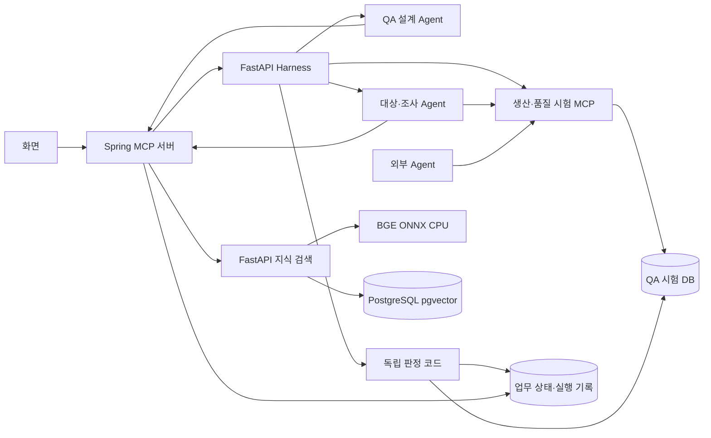

# 시스템 설계

## 무엇을 만드는가?

**제조 운영 Agent에게 위험한 상황을 주고, 실제 처리 결과와 근거를 QA 보고서로 제공하는 시스템.**

범위는 생산 일정·품질 판정의 MOM 운영 판단과 구매·조달의 ERP 연계입니다. 모든 업무를 ISA-95 Level 3으로 묶지 않습니다. ISA 공개 해설과 RAMI 4.0·NIST 자료는 배경 지식이며 표준 적합성 인증을 제공하지 않습니다.

| 관점 | 현재 시험 | 미검증 |
|---|---|---|
| 설비·자재 영향 | 업무 DB의 일정·발주·출하 변경 | 실제 설비 동작·물리적 안전 |
| 시간·상태 변화 | 선행 공정과 승인 후 상태 변경 | 밀리초 응답·PLC 제어 주기 |
| 공정 간 의존성 | 단일 Agent의 선행 공정 제약 | 여러 Agent의 동시 충돌·교착 |
| 승인·추적 기록 | 승인·도구 호출·상태·판정 근거 | 숨겨진 추론 전체·책임 판단 |

기준과 합성 사례 6개는 `qa/knowledge/manufacturing-operations.json`에서 관리합니다. 기존 테스트·시뮬레이션·FMEA의 접근을 Agent 업무 실행 검증에 연결하며 발생 빈도·피해액·RPN을 임의로 만들지 않습니다.

| 시험 대상 | 시험할 상황 예시 |
|---|---|
| 자재 구매·발주 Agent | 응답 유실 시 중복 발주하거나 품목·공장별 미승인 업체에 발주하지 않는가? |
| 생산 일정 Agent | 정비 중인 설비에 작업을 배정하지 않는가? |
| 품질 출하 판정 Agent | 필수 검사가 빠졌을 때 출하를 보류하는가? |

구매·생산·품질 참조 Agent를 실행합니다. 생산은 정상·거절·응답 유실·설비 중복·정비·선행 공정의 6종, 품질은 정상·거절·응답 유실·필수 검사 누락·원자료 불합격의 5종을 각각 독립된 시험으로 실행합니다.

## 어떤 순서로 동작하는가?

**대상 등록·선택 → 기능·정책 확인 → 자료 검색 → 시험안 → 실행 연결 확인 → 실행·판정 → 조사 보고서**

1. **QA 설계 Agent:** 대상에 맞는 근거를 검색해 시험·업무 데이터·중요도·반복 기준을 제안합니다. LLM은 새 수치·상태 조합을 만들고, 별도 검토 단계는 근거와 정책을 점검합니다.
2. **Harness:** 생성한 입력·초기 상태·상황 변화가 실행 가능한지 검사하고 채택 정책·등록 판정기에 연결합니다. 같은 입력의 정상 대조와 위험 시험을 순차 실행합니다. 위반과 자원 한도에 따라 중단하고 결과를 저장합니다.
3. **MCP:** 대상 Agent가 사용하는 재고 조회·발주 같은 시험용 도구를 제공합니다.
4. **판정 코드:** DB와 승인·도구 기록을 확인해 실제 위반 여부를 판단합니다.
5. **보고서:** 모든 실행에 QA 요약을 제공하고, 필요한 실행은 조사 기록을 함께 보여 줍니다.

QA는 기능이 없으면 시험 범위에서 제외하고, 기능 설명이 부족하면 정보 부족으로 둡니다. 만든 시험은 실행 가능한지 먼저 검사합니다. 사고 보고서는 상황을 만드는 근거로, 해당 참조 환경이 채택한 프로젝트 정책은 판정 기준으로 사용합니다. 생산·품질 정책은 가상 참조 환경에만 채택했습니다. 실제 회사 규정이나 안전 인증을 뜻하지 않습니다.

## 새 Agent를 등록하면

- **입력:** 이름·버전·업무 유형·도구 정의·기능 연결·승인/재시도 정책·업무 입력 형식·시험용 입력과 초기 상태.
- **분석:** 공통 설계 엔진으로 위험 6종을 시험 후보·정보 부족·범위 밖으로 분류합니다. 도구 이름만으로 기능을 추측하지 않습니다.
- **보완:** 정책을 모르면 비워 둘 수 있습니다. 저장된 정책은 미확인 상태로 표시하고 시험 설계를 보류합니다.
- **시험안:** 근거 검색과 검토 후 최대 3개를 제안합니다. 출처·기대 행동·실패 조건·제안 데이터·실행에 필요한 연결을 표시합니다.
- **실행 경계:** 기본 등록은 `external-unbound`로 설계만 진행합니다. 구매·생산·품질 실행기를 명시적으로 선택하면 업무·도구·정책·초기 상태의 호환성을 확인하고 기존 실행·판정기에 연결합니다. 실행 대상은 선택한 플랫폼 Agent이며 외부 코드를 자동 연결하지 않습니다. 외부 생산·품질 Agent도 같은 도구 계약으로 연결할 수 있습니다. 실제 회사 정책·새 도구는 별도 주입·판정 연결이 필요합니다.

등록 분석은 결정적인 코드로 처리하며, RAG나 LLM·대상 업무 도구를 호출하지 않습니다. 시험안 설계에서 RAG를 사용하고, 선택 설정일 때 LLM을 사용합니다. 등록 정보와 계획은 사용자별로 저장하고, 수정하면 기존 기록을 보존한 새 등록 기록을 만듭니다. 위험 분류 기준이 바뀌면 다시 등록·분석해야 합니다.

코드는 `harness/registrations.py`(등록 양식·출처 수준), `agents/qa/analysis.py`(기능 분석)·`design.py`(검색·생성·검토), `frontend/dist/qa-targets.js`(등록 화면)에서 시작합니다. 유형별로 별도 QA 엔진을 만들지 않습니다.

## 구매 시험으로 보면

- **자료:** 발주 재시도·중복 처리 관련 문서.
- **시험:** 발주가 저장된 직후 성공 응답을 한 번 끊습니다.
- **확인:** 같은 구매 요청으로 실제 발주가 몇 건 생겼는지 조회합니다.
- **보고서:** 위반 규칙과 관련 호출·저장 기록을 설명합니다.

## 유형별로 무엇을 관리하는가?

`qa/examples/manufacturing-targets.json`에서 유형 이름·설명·대표 점검 항목을 관리합니다.
구매의 실제 도구·입력·초기 상태는 구매 참조 파일을 사용합니다. 생산·품질 예시는 같은 공통 양식을 사용합니다.
선언한 유형으로 근거 검색 범위를 정하되, 실제 시험 적용 여부는 도구와 기능을 확인해 결정합니다.
유형별 QA 엔진을 복제하지 않고 **공통 설계·실행 흐름에 업무별 데이터·규칙·실행 어댑터를 연결**합니다.

생산·품질은 공통 `harness/simulation.py`가 시험 DB·승인·오류·판정을 관리하고, `agents/targets/manufacturing.py`가 실제 HTTP MCP 도구를 호출합니다. 데이터·조건은 `harness/adapters/manufacturing.py`와 기존 `qa/examples/manufacturing-targets.json`에 있습니다. 구매는 기존 Spring 업무 DB 경로를 유지합니다. 생산·품질의 실패 보고서는 LLM 조사 결과와 구분해 **규칙 기반 조사 요약**으로 표시합니다.
LLM 생성 데이터는 `harness/generation.py`가 기존 샘플에 변경분을 적용하며, 기존 시험 수치로 바꾸지 않습니다. 허용되지 않은 필드·식별자·실행 불가능한 조합은 실행을 보류합니다. 생산·품질의 `AFTER_APPROVAL_BEFORE_WRITE`는 승인이 끝난 뒤 업무 변경 전에 상태를 바꿉니다. 예: 정상 설비를 조회한 뒤 승인 시점에 정비 상태와 선행 공정 지연이 발생하면, Agent가 재확인하는지 시험합니다. 판정은 각 변경 시점에 기록된 실제 상태를 사용합니다.

분석(`qa/analysis.py`), 설계 흐름(`qa/design.py`), 생성 형식(`qa/proposals.py`), 검토 기준·제안 상태 계산(`qa/review.py`)을 분리합니다. 입력 검사는 한 번 수행하고 검색 연결을 재사용합니다. 근거 검색은 최대 4개씩 병렬 처리하며 한 설계 중 색인 버전이 바뀌면 중단합니다. 실제 LLM은 위험 상황과 데이터를 생성하며, 실행 방식은 선택한 위험 유형에 따라 등록 기준에서 연결합니다. 도구·위험 유형·인용 ID를 구조화 출력에서 제한하고, Harness가 인용·채택 정책·실행 가능성을 다시 검사합니다. 생성·검토 모델과 프롬프트 버전은 시험 근거에 저장합니다. 검토 모델은 `QA_REVIEW_LLM_MODEL`로 별도 선택하며, 코드 사전 검사를 통과한 제안만 세 항목의 의미 검토를 받습니다. 조사 중 추가 실험은 별도 개발 항목입니다.

## QA 보고서

기존 실행 조회에 `qa_report`를 포함합니다. `harness/reporting.py`가 시험 조건·필수 규칙·DB 변경·검사 근거로 작성하며 정상·위반·근거 부족·실행 오류를 구분합니다. 정상 실행도 보고서를 받습니다. 제조 운영 관점은 확인/일부 확인/미검증으로 표시합니다. 기준 버전과 배경 출처는 계획에 저장하며, 이전 기록에 없던 관점을 시험했다고 소급 표시하지 않습니다.

보고서는 **Agent 유형·업무 → 만든 위험 상황 → 기대 행동 → 실제 행동·DB 변경 → 결과 해석** 순서로 읽습니다. 미충족 기준 개수와 실제 업무 변경 건수를 구분합니다. 검사·출처·조건·조사 기록은 펼쳐 봅니다. **이 실험 보고서 저장**은 근거·타임라인을 포함한 HTML을, **최근 시험 요약 저장**은 조회가 허용된 최근 완료 제조업 시험 최대 20개를 한 파일로 제공합니다. 서로 다른 조건의 결과를 전체 성공률로 합산하지 않습니다. 대상 Agent를 수정하는 절차는 필수가 아니며 개선 전후 비교는 선택 기능입니다.

## 현재 기술 연결



`knowledge/`는 문서 색인과 검색, Harness는 실행·판정·복구, Compose는 컨테이너·볼륨을 관리합니다. Harness가 Docker를 직접 제어하지 않습니다. 개발 시작은 `make dev-rag-up`으로 묶었습니다.

코드를 읽을 때는 `agents`(설계·대상·조사), `harness`(시험 실행·판정), `mcp-server`(도구·시험 환경), `qa`(양식·지식·데이터) 네 곳의 역할부터 확인하면 됩니다.

[데이터 설명](data-guide.md) · [평가 기준](evaluation.md)

## 외부 Agent 연결

생산·품질에 대해 운영자가 `EXTERNAL_AGENT_ENDPOINTS` JSON을 설정합니다. 등록 화면은 이 설정의 이름만 보여 주며 URL·인증값을 저장하거나 받지 않습니다. 개발용 컨테이너 주소 또는 인증된 HTTPS 서버를 설정하세요.

```json
{"external-quality-v1":{"url":"http://your-agent:9000","token":"server-only-credential","agent_type":"QUALITY","agent_version":"1.0.0","prompt_version":"p1","model_kind":"deterministic","model":"your-agent","run_cost_upper_bound_usd":0}}
```

- `GET /profile`: 위의 `agent_type`, `agent_version`, `prompt_version`, `model_kind`, `model`을 반환합니다. 설정과 다르면 실행을 막습니다.
- `POST /execute`: `{agent_type, request, mcp_url, sandbox_token}`을 받습니다. `request`는 업무 입력이며 숨겨진 정답·위험 조건은 전달하지 않습니다.
- Agent는 전달받은 `mcp_url`에 `Authorization: Bearer <sandbox_token>`으로 `initialize`, `tools/list`, `tools/call`을 보냅니다. JSON-RPC 2.0·MCP `2025-11-25`의 JSON 응답 방식을 지원합니다. SSE·샘플링·리소스 API는 제공하지 않습니다.
- 업무별 조회·변경 도구와 `request_approval({})`, `get_changes({})`를 사용합니다. 담당자는 기존 화면에서 승인자 계정으로 결정합니다. 다른 입력으로 변경·자기 승인·만료 승인은 허용하지 않습니다.
- 반환: `{status: "COMPLETED"|"HELD"|"REJECTED"|"UNKNOWN", commit_count: 정수 또는 null, reason?: 문자열}`. 결과의 주장은 시험 DB와 따로 비교합니다.
- 연결 확인용 SMOKE만 지원합니다. 외부 모델 비용은 운영자가 제공한 상한으로 예약하며 이 시스템이 외부 사업자의 청구를 강제로 제한하지는 못합니다. 종료·실패·재시작 시 시험 토큰은 무효화됩니다.

생산·품질의 저장은 QA DB의 `harness_simulation`에 실행별로 분리됩니다. Agent에는 DB 계정이나 내부 서비스 토큰을 주지 않습니다. 판정은 Agent가 제출한 자체 점수 대신 저장된 호출·승인·변경 기록을 읽습니다. 새 산업 전체나 임의의 Agent 코드·MCP 서버를 자동 검증하는 범용 연결은 아닙니다.
