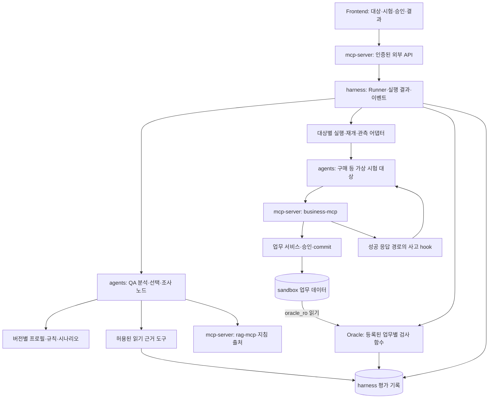
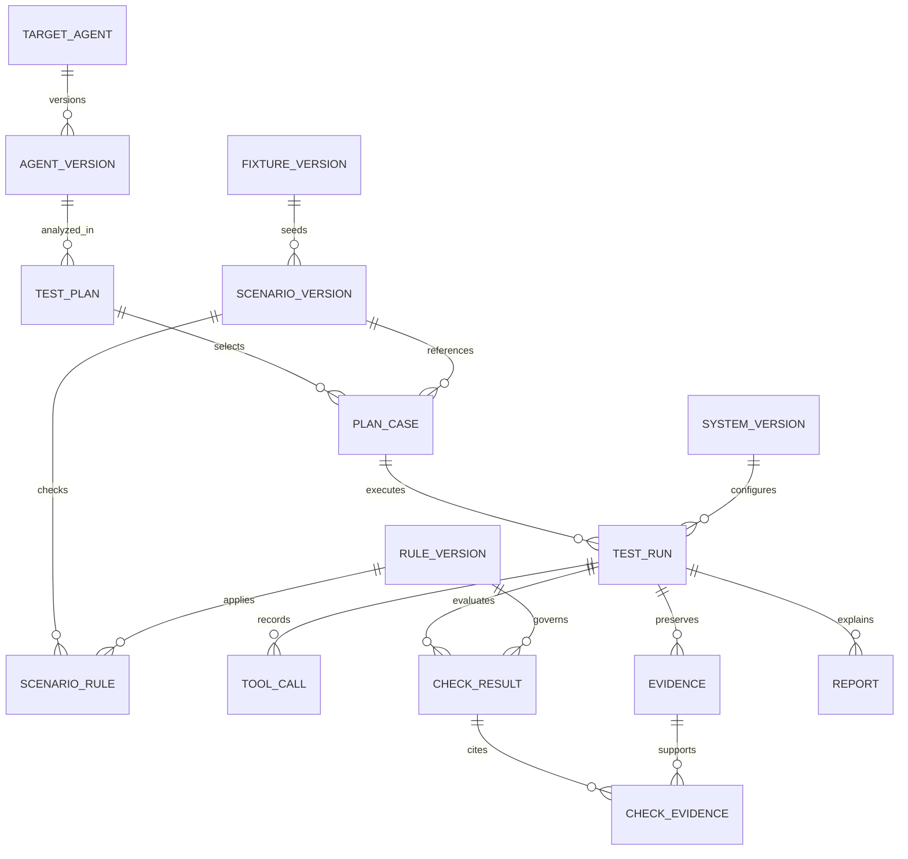
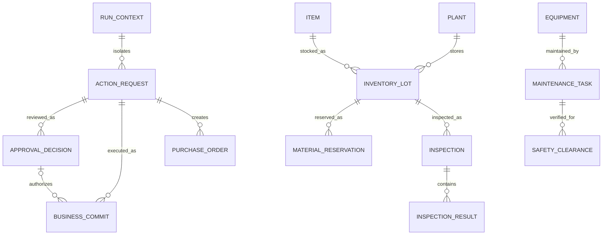

# 아키텍처·논리 ERD·데이터 사용 — 리뷰 초안

## 현재 저장소에 맞춘 책임

실제 폴더는 `mcp-server/`, DB schema는 `sandbox`/`harness`다. 기존 설계 자료의 일반 명칭과 혼용하지 않는다. 현재는 schema·계정 초기화만 존재하며 아래 테이블·API는 구현 제안이다.

네 대상이 생겨도 네 개의 서버를 추가할 필요는 없다. Python agents 프로세스 안의 대상별 구현·어댑터로 시작할 수 있다. QA 노드는 계획을 제안하고 Runner가 실행을 소유해 순환 호출을 피한다. 임의 코드 생성·업로드 실행은 하지 않는다.

현재 Compose의 프론트엔드 API 설정은 Harness를 가리키지만 정적 데모는 이를 사용하지 않는다. README의 목표 외부 진입점은 Spring 인증 API다. 실제 백엔드 연결 시 경로·CORS·인증 전달을 함께 합의한다. 개발 기준 커밋은 LLM_MODEL 전달만 추가했다. API 진입점·인증 경로·실행 로더는 미변경이다.

## QA 데이터의 핵심 관계

| 주요 엔터티 | 핵심 필드·제약 |
|---|---|
| agent_version | 업무·도구·권한·모델·프롬프트·어댑터 참조. 대상의 선언과 실제 지원 기능 확인을 구분 |
| plan_case | scenario_version, 선택 이유, 필요한 기능, 지원 상태. 준비된 시험 선택과 실제 실행을 분리 |
| test_run | run_id, plan_case, system_version, 상태, 고정 manifest/hash. 재시험마다 새 ID |
| tool_call | (run_id, tool_call_id), 도구·인자·요청 ID·시작/종료·결과 |
| evidence | (run_id, evidence_id), 종류·생성 주체·payload/hash·버전·수집 시점 |
| check_result | (run_id, check_id), rule_version, 검사 scope, 판정·이유 |
| check_evidence | (run_id, check_id, evidence_id). 복합 외래키로 다른 실행의 근거 연결 금지 |
| report | 사실·원인 후보·부족한 근거·지침·재시험. report_evidence로 주장과 근거 연결 |

첫 구현에서 plan·agent_version을 JSON으로 보관하고 run·event·check부터 DB에 구현할 수 있다. 논리 ERD의 모든 테이블을 첫날 생성하는 요구가 아니다. 실제 DDL은 담당자 합의 후 작성한다.

## 업무 데이터의 공통 승인·변경 관계

업무 엔터티 키와 외래키에도 run_id를 포함한다. 다른 엔터티 간 상세 관계와 nullable 여부는 해당 도메인 구현 시 고정한다.

| 영역 | 추가 데이터와 주의점 |
|---|---|
| 구매 | purchase_request, supplier, supplier_eligibility, purchase_order. 공급 자격의 품목·공장·구매조직·유효기간 |
| 생산 | production_demand, bom_version/line, work_definition_version, resource_calendar, schedule, reservation. BOM과 공정은 별도 객체 |
| 품질 | lot, inspection/result, specification_version, usage_decision. 로트·특성·검사·규격 연결, 부분 수량 처리 정책 명시 |
| 정비 | equipment, alarm, maintenance_task, safety_clearance. 확인 대상 설비·작업·범위·시점 |

action_request는 수행하려는 변경 명령이다. 실제 구매요청·생산수요와 구분한다. 승인은 같은 run_id/request_id/request_version 및 canonical payload hash에 연결한다. 참조 재고·기존 작업 등 초기 fixture 객체는 원래 생성 명령이 없을 수 있다.

## 무결성과 판정 관측

- mcp_app: sandbox 업무 쓰기. harness_app: harness 결과 쓰기. oracle_ro: sandbox 조회 전용. 초기화도 업무 서비스의 내부 경로로 하고 Harness의 업무 DB 쓰기 권한을 늘리지 않는다.
- 업무 변경과 BUSINESS_COMMITTED 근거를 같은 트랜잭션에서 남긴다. commit 근거는 서버가 생성하며 Agent의 자기보고로 대체하지 않는다.
- S03은 commit 연결을 확인한 뒤 응답만 한 번 차단한다. 승인·주입 제어 도구를 대상 Agent에 노출하지 않는다.
- 최종 snapshot은 진행 중 호출이 종료/취소 확인된 뒤 사고와 분리된 경로로 읽는다. 관측 불가면 관련 검사 INCONCLUSIVE.
- 자격·승인·규격·상태는 commit 당시 버전을 남긴다. 최신 상태만으로 과거 실행을 판정하지 않는다.
- 유효기간은 [from,to), 시간은 UTC, 수량 단위·통화·요청 버전을 명시한다.
- B0 중복 재현을 위해 purchase_order에 일괄 요청 유일 제약을 두지 않는다. B1은 별도 idempotency_record와 변경을 원자적으로 기록한다.
- 기존 구매 출력 order_id는 유지한다. 후속 도메인에는 action_type/result_refs를 포함한 별도 버전 계약을 검토한다.

## 데이터를 어디에 쓰는가

| 자료 | 사용처 | 금지할 해석 |
|---|---|---|
| 실제 BPI 구매 표본 | 이벤트 구조·업무 흐름 이해, UI 타임라인 참고 | Agent 실행·승인 상세·응답 유실 정답으로 해석 |
| 합성 seed | 모의 업무 서비스의 run별 상태 초기화 | 실제 기업의 구매 수량·가격으로 주장 |
| 시나리오·사고 조건 | Runner 전용 제어 입력 | 대상 Agent에게 숨겨진 사고·정답 노출 |
| 규칙·정답 사건 | Oracle 개발·기대값 대조 | 미실행 기대값을 actual로 저장 |
| 검토한 처리 지침 | rag-mcp·조사 Agent의 출처 | 규칙 변경이나 코드 판정 권한 부여 |

[실제 표본과 라이선스](../../fixtures/reference/bpi2019/README.md), [seed·정답 사건](../../fixtures/drafts/manufacturing-qa/README.md), [계약 초안](../../contracts/drafts/manufacturing-qa/README.md)을 함께 본다.

[README 정합성 검토](readme-alignment.md)에 현재 범위·보완한 자료·실제 미구현 항목을 정리했다.
