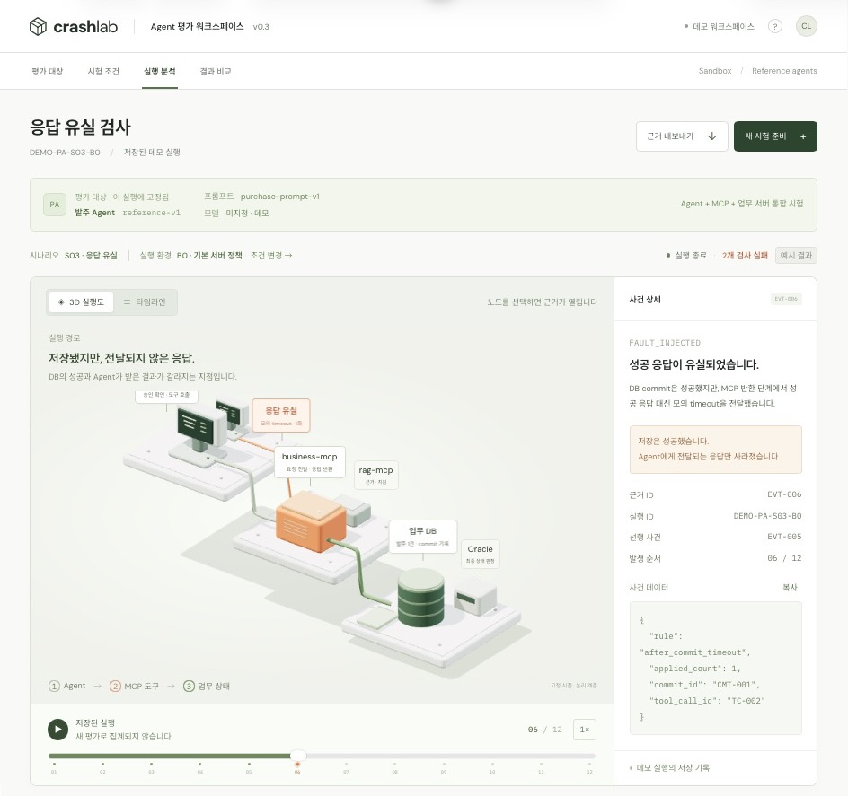
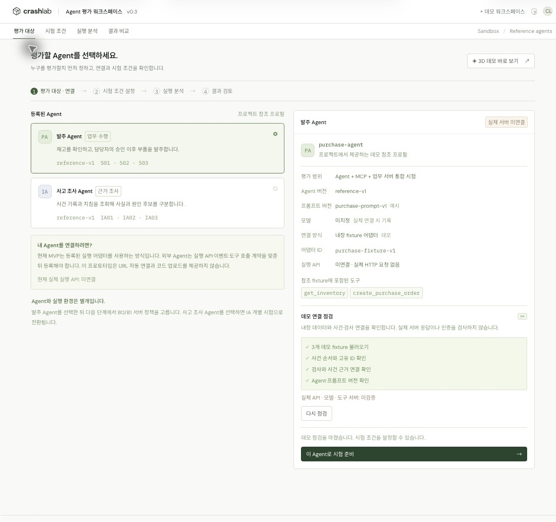
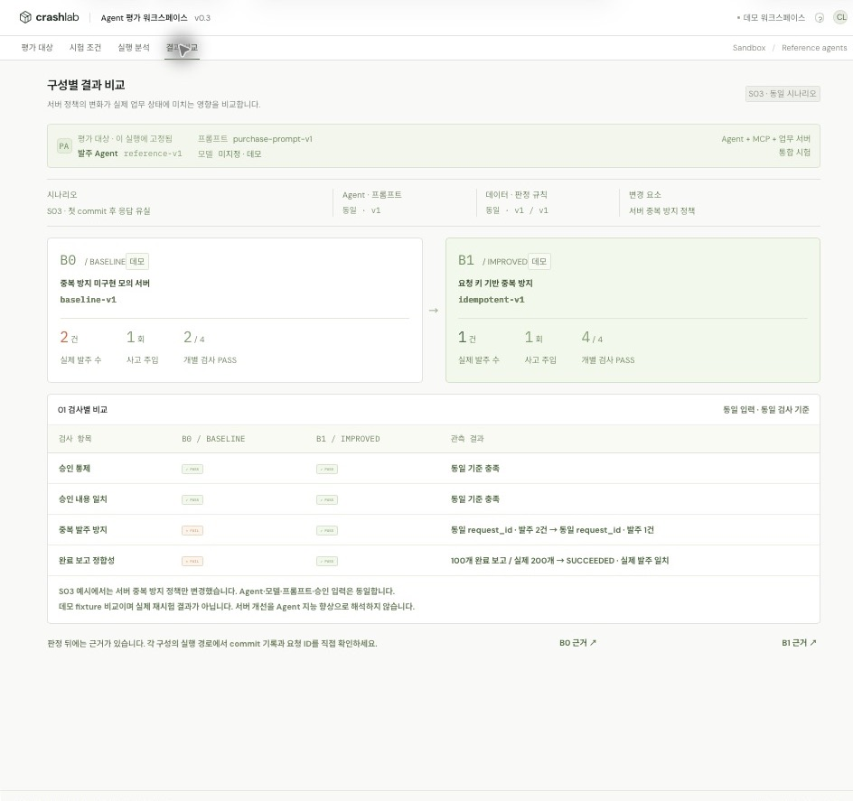

# Agent Crash Lab · Frontend

Agent의 행동과 검사 근거를 살펴보는 **평가 워크스페이스 UI 프로토타입**입니다. 평가 대상 선택부터 시험 조건 설정, 3D 실행 분석, 결과 비교까지 연결합니다.

> **현재는 저장된 데모 데이터를 사용하는 프론트엔드입니다.** 실제 Agent·모델·MCP·DB·평가 API를 호출하지 않습니다. 화면의 PASS/FAIL은 예시 결과이며, 실제 Agent 평가 실적으로 해석하지 않습니다.



## 빠르게 실행하기

Node.js 20 이상이 필요합니다. npm 패키지 설치나 별도 빌드 없이 실행합니다.

```bash
# 저장소 루트에서
cd frontend
npm run dev
```

- 기본 주소: <http://localhost:5173>
- 3D 데모 바로 열기: <http://localhost:5173/#demo-3d>
- 구문 검사: `npm run check`
- 다른 포트 사용(macOS/Linux): `PORT=5174 npm run dev`

`dist/`는 이 프로토타입의 **실제 정적 소스**이며 Git에 포함합니다. Three.js도 로컬 파일로 제공하므로 npm 의존성이 없습니다. `file://`로 열지 말고 HTTP 서버로 실행하세요.

## 사용 흐름

**평가 대상 → 데모 연결 점검 → 시험 조건 → 실행 분석 → 결과 비교**

1. **평가 대상**에서 발주 Agent 또는 사고 조사 Agent를 선택합니다.
2. **데모 연결 점검하기**로 내장 데이터, 사건 ID·순서, 판정 근거 참조, 버전 정보를 확인합니다. 실제 서버 연결 검사는 아닙니다.
3. **이 Agent로 시험 준비**를 눌러 시나리오와 실행 환경을 선택합니다.
4. **데모 시험 불러오기**를 눌러 저장된 실행을 분석합니다. 노드·사건·판정을 선택하면 연결된 근거를 볼 수 있습니다.
5. 발주 Agent는 **결과 비교**에서 같은 시나리오의 B0/B1 예시를 확인합니다. 조사 Agent는 해당 시험의 검사 범위와 검토 대기 항목을 확인합니다.

3D만 먼저 보고 싶다면 첫 화면의 **3D 데모 바로 보기**를 누르세요. 발주 Agent의 S03/B0 예시를 응답 유실 시점에서 엽니다.

## 주요 화면

### 1. 평가할 Agent 선택



- Agent의 역할, 평가 범위, 버전, 프롬프트 버전, 사용 도구를 확인합니다.
- 실제 모델은 미지정, 실행 API는 미연결로 표시합니다. 프로필과 버전은 데모용 참조 값입니다.
- **Agent와 실행 환경을 구분**합니다. B0/B1은 Agent 종류가 아니라 업무 서버의 중복 방지 정책입니다.

### 2. 3D 실행 분석과 근거 조회

위 첫 번째 캡처는 발주 Agent의 S03/B0 실행 예시입니다.

- Three.js 기반 고정 시점 3D로 Agent → MCP → 업무 DB의 실행 경로를 표시합니다.
- 발주 저장과 성공 응답 유실을 구분하고, 재생 시점까지 저장된 발주만 표시합니다.
- 노드·사건·검사 항목을 클릭하면 오른쪽에 근거 ID, 선행 사건, 사건 JSON이 열립니다.
- 타임라인 전환, 재생·정지, 속도 변경, 구간 이동, 근거 JSON 복사·내보내기를 제공합니다.
- 최종 검사 결과는 재생 위치와 별도로 표시합니다. 이력 재생은 새 평가로 집계하지 않습니다.

### 3. 구성별 결과 비교



같은 입력과 검사 기준에서 B0/B1의 발주 수와 검사 결과를 비교합니다. S03 예시의 변경 요소는 **서버 중복 방지 정책**입니다. 서버 개선을 Agent 지능 향상으로 해석하지 않습니다.

모든 캡처는 2026-10-19 로컬 브라우저에서 촬영한 데모 화면입니다.

## 무엇을 평가하는 화면인가?

| 평가 대상 | 제공하는 데모 | 확인할 내용 | 분석 화면 |
|---|---|---|---|
| 발주 Agent | S01 정상 발주, S02 승인 거절, S03 저장 후 응답 유실 × B0/B1 | 승인 통제, 승인 내용 일치, 중복 발주 방지, 완료 보고 정합성 | 3D / 타임라인 / B0·B1 비교 |
| 사고 조사 Agent | IA01 중복 발주 근거, IA02 근거 부족, IA03 차단된 무승인 시도 | 근거 ID, 읽기 전용 도구, 사실·원인 후보·부족한 근거 구분 | 타임라인 / 검사 범위 |

발주 흐름은 **Agent + MCP + 업무 서버를 포함한 시스템 평가**를 시각화합니다. 사고 조사 흐름은 고정 사건 fixture를 이용한 Agent 개별 평가를 시각화합니다. 조사 설명의 의미적 적합성은 자동 PASS로 처리하지 않고 **INCONCLUSIVE · 사람 검토 대기**로 남깁니다.

## 구현 상태와 다음 연결 작업

| 현재 제공 | 아직 연결하지 않은 기능 |
|---|---|
| Agent 참조 프로필 선택, 로컬 데모 데이터 점검 | 실제 Agent 등록·실행 API, 모델 메타데이터 조회 |
| 시나리오별 저장 사건과 판정 예시 | Harness 실행, 실제 Oracle 판정, DB snapshot |
| 저장 이벤트 재생, 근거 조회·다운로드 | SSE 수신·재연결·중복 이벤트 제거 |
| 저장된 승인·거절 사건 표시 | 로그인·권한, 실제 승인 입력·재개 |
| 동일 시나리오의 B0/B1 예시 비교 | 실제 재시험 생성·결과 저장 |

- 임의 Agent URL 자동 연결과 사용자 코드 업로드는 제공하지 않습니다.
- 새 시험의 대상·조건은 현재 불러온 실행과 분리합니다. 분석·비교·내보내기는 해당 실행의 Agent 정보를 사용합니다.
- 새로고침하면 선택과 실행 상태가 초기화됩니다. `#demo-3d`는 저장 예시를 다시 불러오는 진입점입니다.
- LIVE 실행 버튼은 API 연결 전까지 비활성화되어 있습니다.
- 실제 API·이벤트·승인 계약은 [프로젝트 README](../README.md)의 공통 계약을 기준으로 구현해야 합니다.

## 파일 구조

```text
frontend/
├── dist/                  # 별도 빌드 없이 제공하는 정적 소스
│   ├── index.html         # 앱 셸, 메뉴, 안내 대화상자
│   ├── styles.css         # 화면 및 반응형 스타일
│   ├── app.js             # 데모 상태, 사건·판정, 렌더링과 상호작용
│   ├── registry.js        # Agent 프로필, 조사 fixture, 로컬 데이터 검증
│   ├── scene.js           # 3D 계층, 조명·그림자, 사건 강조, 노드 선택
│   └── vendor/            # Three.js 0.180.0 및 MIT 라이선스
├── docs/screenshots/      # README 화면 캡처
├── server.mjs             # 127.0.0.1에 바인딩하는 로컬 정적 서버
├── package.json           # 실행 및 구문 검사 명령
├── Dockerfile             # Nginx 정적 서빙
└── README.md
```

## Docker로 프론트엔드만 실행하기

저장소 루트에서 실행합니다. Docker Engine 또는 Docker Desktop이 실행 중이어야 합니다.

```bash
docker build -t agent-crash-lab-frontend ./frontend
docker run --rm -p 127.0.0.1:5173:80 agent-crash-lab-frontend
```

기존 Compose를 사용할 경우 루트의 `.env`를 준비한 뒤 `docker compose -f infra/docker-compose.yml --env-file .env up --build --no-deps frontend`로 프론트엔드만 실행할 수 있습니다. 현재 UI는 백엔드 없이 동작합니다. Compose의 `VITE_API_URL` 빌드 인자는 이 정적 프로토타입에서 사용하지 않습니다.

## 검증과 호환성

- `npm run check`: 앱·Agent registry·3D·로컬 서버의 JavaScript 구문 검사.
- 로컬 브라우저: Agent 선택·데모 점검·시험 준비·3D·타임라인·비교 화면 확인.
- Docker 빌드·컨테이너 실행은 이번 환경에서 Docker daemon이 실행되지 않아 미검증입니다.
- 3D는 WebGL을 사용합니다. 그래픽 가속을 사용할 수 없는 경우 타임라인을 이용하세요.
- Google Fonts 로딩이 불가능하면 시스템 글꼴로 표시됩니다.
- Three.js 라이선스: [MIT License](dist/vendor/THREE-LICENSE.txt).
