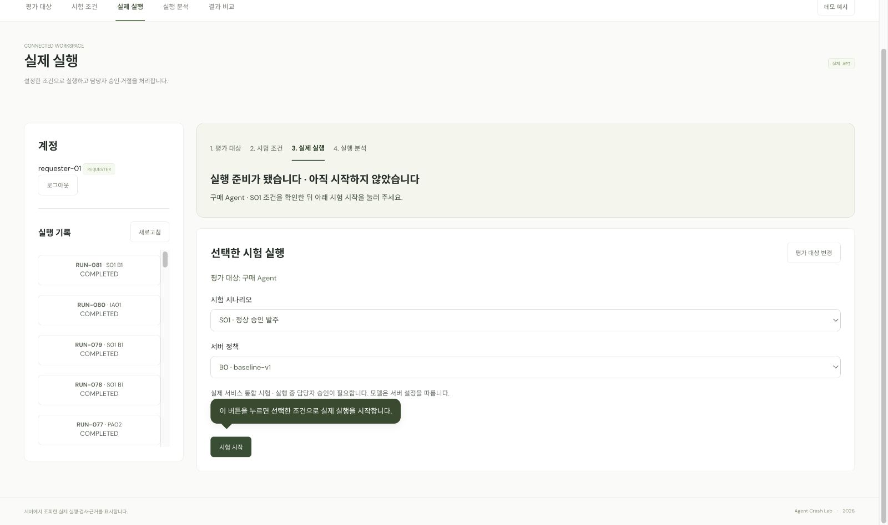
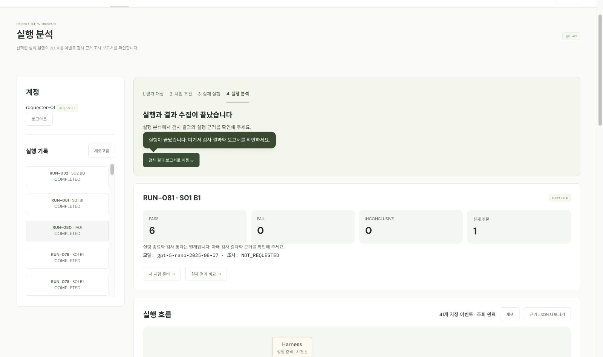
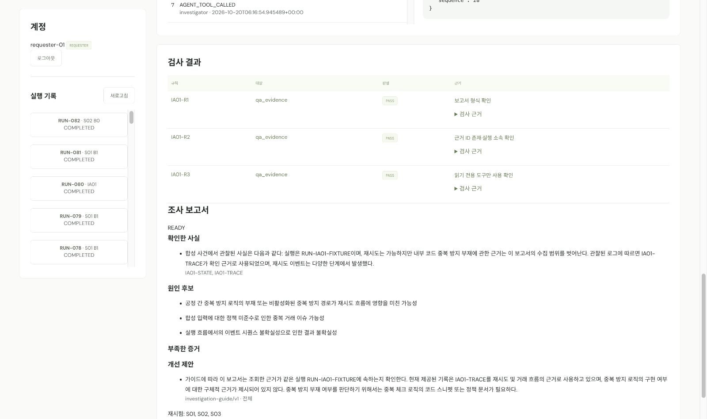
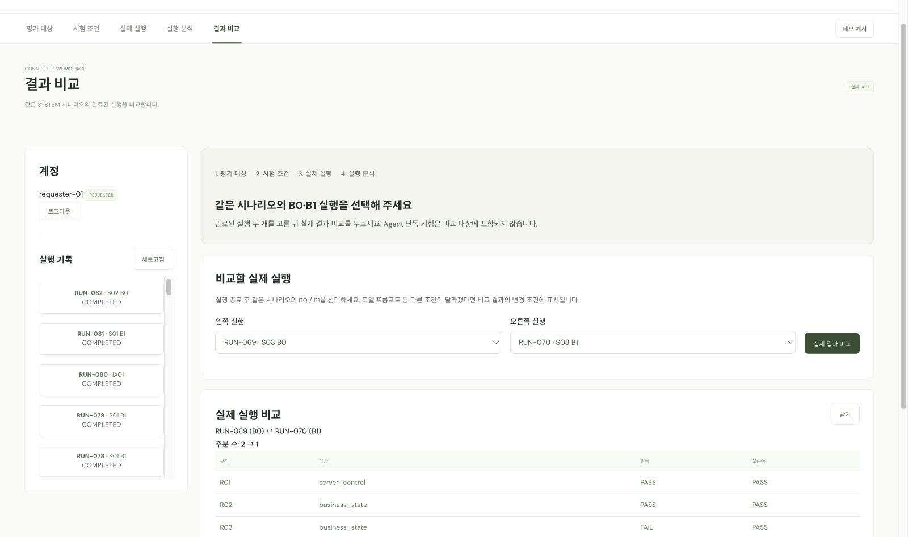

# Agent Crash Lab · Frontend

구매·사고 조사 Agent의 시험 실행, 담당자 승인, 진행 기록, 검사 결과와 조사 보고서를 확인하는 웹 화면입니다. 메인 메뉴는 실제 MCP·Harness·Agent 서비스에 연결하며, 우측 **데모 예시**는 내장 데이터로 동작합니다.

## 처음 실행하기

전체 저장소의 최신 코드를 받고 **저장소 루트**에서 실행합니다. 아래 명령은 `frontend/` 안에서 실행하는 명령이 아닙니다.

필요한 도구는 Docker Desktop 또는 Docker Engine, Docker Compose **2.24.4 이상**, `make`입니다. 전체 서비스를 Docker로 실행할 때는 로컬 Node.js·Python·Java 설치가 필요하지 않습니다.

```bash
# 기존 .env가 있으면 유지합니다.
[ -f .env ] || cp .env.example .env
```

루트 `.env`에서 다음 값을 확인합니다.

| 설정 | 개발 시 사용 방법 |
|---|---|
| `INTERNAL_API_TOKEN` | 반드시 비어 있지 않은 개발용 값을 지정합니다. MCP·Harness·Agent가 같은 값을 사용합니다. |
| `DEMO_USER_PASSWORD` | 개발 계정 공통 비밀번호. `.env.example`의 기본값은 `crashlab`입니다. |
| `AGENT_MODEL_MODE` | `offline`이면 LLM 키 없이 결정형·fixture 모델로 시험합니다. 실제 LLM 호출은 `openai`를 명시합니다. |
| `LLM_API_KEY` | `openai` 모드에서만 필요한 OpenAI API 키입니다. |
| `LLM_MODEL` | 실제 LLM을 쓸 때 지정합니다. 현재 저가 시연 모델은 `gpt-5-nano-2025-08-07`입니다. |
| `PURCHASE_LLM_MODEL`, `INVESTIGATION_LLM_MODEL` | 구매·조사별 모델을 별도로 지정할 때 사용합니다. 비어 있으면 `LLM_MODEL`을 따릅니다. |
| `LLM_BUDGET_STAGE` | 기본 `smoke`. 실제 호출에는 Agent의 누적 비용 제한이 적용됩니다. |
| `FRONTEND_PORT` | 기본 `5173`. 다른 프로그램이 쓰고 있으면 변경합니다. |

예를 들어 유료 호출 없이 먼저 확인하려면 `AGENT_MODEL_MODE=offline`으로 둡니다. 이 설정은 **모델 실행 방식**이며, 전체 서비스 실행 시 프론트와 백엔드는 실제 API로 연결됩니다. 조사 단독 시험은 준비된 fixture를 사용합니다.

```bash
make dev-harness-up
make dev-ps
```

서비스가 준비되면 <http://127.0.0.1:5173/#agents>에 접속합니다. 포트를 변경했다면 변경한 주소를 사용하세요. `make dev-up`과 `make dev-mcp-up`에는 Harness가 포함되지 않으므로 전체 시연에는 **`make dev-harness-up`**을 사용합니다.

실제 LLM을 사용하려면 `.env`에서 `AGENT_MODEL_MODE=openai`, API 키와 모델을 설정하고 `make dev-harness-up`을 다시 실행합니다. 새 실행에 API 비용이 발생하며, 한도에 도달하면 유료 호출을 중단합니다. 키와 내부 토큰은 FE 소스에 넣지 않습니다.

## 실제 시연 순서

### 구매 실행과 승인

1. `requester-01`과 `DEMO_USER_PASSWORD` 값으로 로그인합니다. 기본 개발 비밀번호는 `crashlab`입니다.
2. **평가 대상**에서 구매 Agent를 선택하고 **시험 조건 설정**으로 이동합니다.
3. `S01`·`B1`을 선택하고 **이 조건으로 실행 준비**를 누릅니다. 이 단계에서는 아직 실행하지 않습니다.
4. **시험 시작**을 누릅니다. 접수된 실행 번호와 진행 상태가 표시되고 새 시작 폼은 숨겨집니다.
5. 승인 대기가 되면 **승인 요청 확인**을 누릅니다. 요청 내용을 확인하고 `approver-01`과 같은 개발 비밀번호로 승인합니다. 거절하면 발주 없이 종료합니다.
6. 완료 안내의 **결과 확인**으로 이동합니다. **검사 결과·보고서로 이동**을 누르면 3D 아래의 결과를 바로 확인할 수 있습니다.

정상적인 S01/B1 실행의 확인 기준은 발주 1건과 검사 결과입니다. `COMPLETED`는 실행 종료를 뜻하며, 모든 검사의 통과를 뜻하지 않습니다. 진행 중에는 상태를 자동 조회하고, 사용자 조치가 필요할 때 해당 버튼·승인 폼 옆에 말풍선을 표시합니다.

### 한국어 조사 보고서

**새 시험 준비**에서 사고 조사 Agent를 선택하고 `IA01`을 실행합니다. 별도 승인 없이 준비된 사건 근거를 조회하고 보고서를 작성합니다. 완료 후 **실행 분석**에서 확인 사실·원인 후보·부족한 증거·개선 제안·출처를 확인합니다.

새로 생성하는 LLM 보고서의 설명 문장은 한국어로 작성하며, 근거 ID와 문서 출처 값은 원문을 유지합니다. 기존 저장 보고서는 다시 작성하지 않습니다. 보고서 구조와 출처 검증 통과만으로 설명 품질까지 보장하지는 않습니다.

### B0/B1 결과 비교

같은 `S03` 시나리오를 `B0`, `B1`에서 각각 실행하고 승인한 뒤 **결과 비교**에서 두 실행을 선택합니다.

- B0: 저장 후 응답 유실과 재시도로 발주 2건이 생기는 기준 사례입니다. 관련 검사의 FAIL은 시연 대상인 중복 발주를 드러냅니다.
- B1: 같은 요청의 응답을 재사용해 발주 1건을 유지하는 비교 사례입니다.

B0/B1은 **서버 중복 방지 정책**입니다. 모델·프롬프트 등 다른 조건도 함께 확인하고, 서버 정책 개선을 Agent 성능 향상으로 해석하지 않습니다. PA·IA 단독 시험은 이 비교의 대상이 아닙니다.

## 화면과 데이터

| 메뉴 | 기능 |
|---|---|
| 평가 대상 | 서버가 제공하는 구매·조사 Agent와 시험 목록 확인 |
| 시험 조건 | 시나리오와 SYSTEM 시험의 B0/B1 정책 선택 |
| 실제 실행 | 실행 접수·상태 조회·승인·거절 |
| 실행 분석 | 실제 이벤트 기반 3D·재생·근거 조회·검사 결과·보고서·JSON 내보내기 |
| 결과 비교 | 완료된 SYSTEM 실행의 주문 수·판정·고정 조건·변경 조건 비교 |

메뉴를 이동해도 선택한 조건과 실행은 유지됩니다. 새 시험을 시작하려면 **새 시험 준비**에서 조건을 확인합니다. 새로고침하면 메모리에 있던 로그인 세션이 사라지므로 다시 로그인하고 저장된 실행 기록을 여세요.

실행 기록은 각 개발자의 로컬 백엔드에 저장됩니다. 다른 개발자의 실행 ID나 주문 기록이 자동으로 공유되지는 않습니다. 동시에 진행할 수 있는 실행·조사는 하나입니다.

## 주요 화면

아래 화면은 데모 데이터가 아니라 로컬 MCP·Harness·Agent에 연결해 생성한 실제 실행 기록입니다. 실행 ID는 개발 환경마다 달라집니다.

### 1. 실행 준비와 다음 행동 안내

선택한 Agent·시나리오·서버 정책을 마지막으로 확인합니다. 이 단계에서는 아직 실행하지 않았으며, 말풍선이 실제 실행을 시작하는 버튼을 안내합니다.



### 2. 구매 실행 결과와 3D 흐름

완료된 구매 실행의 검사 요약, 실제 주문 수, 사용 모델과 저장 이벤트를 함께 확인합니다. **검사 결과·보고서로 이동**을 누르면 3D 아래의 상세 판정으로 바로 이동합니다.



### 3. 한국어 사고 조사 보고서

조사 Agent가 조회한 근거로 작성한 확인 사실·원인 후보·부족한 증거·개선 제안입니다. 본문은 한국어로 생성하고 근거 ID와 지침 출처는 원문 값을 유지합니다.



### 4. B0/B1 실제 결과 비교

같은 S03 시나리오에서 B0와 B1 실행을 비교합니다. 이 화면에서는 실제 주문 수가 2건에서 1건으로 바뀌고 관련 검사 판정도 함께 달라지는 것을 확인할 수 있습니다.



## FE만 수정하며 실행하기

Node.js **20 이상**이 필요합니다. npm 패키지 설치나 별도 빌드 없이 실행합니다. 아래 명령은 **저장소 루트** 기준입니다.

```bash
cd frontend
npm run dev
```

기본 주소는 <http://127.0.0.1:5173>입니다. 백엔드 없이도 **데모 예시**를 볼 수 있지만, 실제 로그인·실행에는 MCP·Harness·Agent가 필요합니다.

전체 Docker 서비스를 이미 실행했다면 5173 포트가 사용 중이므로 Node 개발 서버는 다른 포트로 실행합니다.

```bash
# frontend/에서 실행
PORT=5174 MCP_API_URL=http://127.0.0.1:8081 npm run dev
```

이 경우 <http://127.0.0.1:5174>로 접속합니다. MCP 호스트 포트를 변경했다면 `MCP_API_URL`도 맞춥니다. Docker 프론트는 Nginx가, Node 개발 서버는 `server.mjs`가 `/api`를 MCP로 전달합니다. FE 파일을 수정해도 실행 중인 Docker 화면에 자동 반영되지는 않습니다.

```bash
# 저장소 루트에서 Docker 프론트만 다시 빌드
# 기존 개발용 DB 볼륨은 유지합니다.
docker compose -f infra/docker-compose.yml -f infra/docker-compose.dev.yml --env-file .env up -d --build --no-deps frontend
```

## 연결 구조

```text
브라우저 /api → Nginx 또는 Node 개발 서버 → MCP 공개 API
  로그인·승인: MCP에서 처리
  시험 목록·실행·이벤트·비교: MCP → Harness
  실행: Harness → Agent → MCP 도구 → 업무 DB
  승인 재개: MCP → Harness → Agent
```

- 브라우저는 사용자 로그인 토큰만 사용합니다. 내부 토큰과 사용자 식별 헤더는 서버에서 처리합니다.
- 진행 상태와 이벤트는 JSON으로 1초마다 조회합니다. 이벤트 순번으로 이어받고 최종 수집이 끝나면 멈춥니다. FE는 SSE를 사용하지 않습니다.
- 조회 실패는 재접속하지만 실행 생성·승인은 자동 재전송하지 않습니다.
- 주문 수는 서버가 관측한 값입니다. 관측 전에는 `—`로 표시하며, 화면에서 commit이나 판정을 만들어내지 않습니다.

## 데모 예시

우측 **데모 예시**는 서버 없이 내장 데이터를 탐색하는 별도 화면입니다. 실제 실행·검사 결과와 구분합니다.

- 구매 S01~03, 조사 IA01~03 예시와 3D·타임라인을 확인할 수 있습니다.
- **Agent 구조 등록**에서 JSON으로 데모 프로필·노드·연결·샘플 이벤트를 추가할 수 있습니다. 등록 정보는 해당 브라우저에 저장되며 실제 Agent를 배포하거나 API에 등록하지 않습니다.
- `dist/`는 실제 정적 소스입니다. Three.js도 로컬 파일을 사용하며 `file://` 대신 HTTP 서버로 열어야 합니다.

[구조 등록 설명](docs/topology.md) · [등록 JSON 예시](docs/examples/research-agent.json) · [Three.js MIT 라이선스](dist/vendor/THREE-LICENSE.txt)

아래 캡처는 내장 **데모 화면**입니다.


## 확인 명령과 문제 해결

```bash
# frontend/에서 실행
npm run check
npm test
```

현재 FE 테스트는 **22개**이며 공개 API 오류·인증 헤더·쓰기 재전송 금지·이벤트 검증·실행 안내·말풍선 대상·캐시 버전·기존 데모 회귀를 검사합니다. 실제 브라우저에서는 구매 시작→승인→완료→결과 확인과 한국어 조사 보고서를 확인했습니다. 다른 개발자의 초기 환경과 모바일 실기기 검증은 별도입니다.

| 증상 | 확인할 내용 |
|---|---|
| 화면은 열리지만 로그인·실행이 안 됨 | FE만 실행했는지 확인하고 `make dev-harness-up`으로 전체 서비스를 실행합니다. |
| 로그인 실패 | 사용자 ID와 `.env`의 `DEMO_USER_PASSWORD`를 확인합니다. requester와 approver는 역할이 다릅니다. |
| 내부 API 거부·서비스 오류 | `INTERNAL_API_TOKEN`이 비어 있지 않은지 확인하고 설정 변경 후 서비스를 다시 실행합니다. |
| 포트 사용 중 | `.env`의 해당 서비스 포트를 변경합니다. FE만 Node로 개발한다면 `PORT=5174`를 사용할 수 있습니다. |
| 실행 중이라는 안내 또는 409 | 실행 기록에서 진행 중인 실행·조사를 열어 승인 대기 또는 처리 상태를 확인합니다. |
| 보고서가 없음 | `NOT_REQUESTED`이면 해당 실행은 별도 보고서를 생성하지 않습니다. `ERROR`이면 실행 기록의 오류를 확인합니다. |
| 실제 LLM 호출 실패·예산 초과 | Agent 로그와 모델 설정·키·누적 예산을 확인합니다. 실제 호출 실패를 mock 성공으로 대체하지 않습니다. |
| 새 화면이 반영되지 않음 | Docker 프론트를 다시 빌드하고 브라우저를 새로고침합니다. 정적 소스와 내부 모듈은 같은 버전으로 배포합니다. |
| 3D를 표시할 수 없음 | WebGL·그래픽 가속을 확인합니다. 실제 실행의 이벤트 목록과 근거는 별도로 확인할 수 있습니다. |

```bash
# 저장소 루트에서 서비스 상태·로그 확인
make dev-ps
make dev-logs s=frontend
make dev-logs s=mcp-server
make dev-logs s=harness
make dev-logs s=agents

# 개발 서비스 종료: DB·Agent 저장 볼륨 유지
make dev-down
```

## 주요 파일

```text
frontend/
├── dist/
│   ├── index.html       # 앱 셸
│   ├── app.js           # 메뉴 이동·데모 화면
│   ├── live.js          # 실제 실행 화면·승인·진행 안내·말풍선
│   ├── live-api.js      # API 호출·이벤트 병합·상태별 안내
│   ├── styles.css      # 화면 스타일
│   ├── scene.js        # Three.js 실행 흐름
│   ├── topology.js     # 구조 검증·이벤트 매핑
│   ├── topologies.js   # 구조 정의
│   ├── registry.js     # 데모 프로필
│   ├── registration.js # 데모 구조 등록
│   └── vendor/         # Three.js
├── docs/               # 데모 캡처·구조 계약·JSON 예시
├── tests/              # FE 자동 테스트
├── server.mjs          # Node 개발 서버·API 프록시
├── nginx.conf          # Docker 정적 서빙·API 프록시
├── Dockerfile
└── package.json
```
