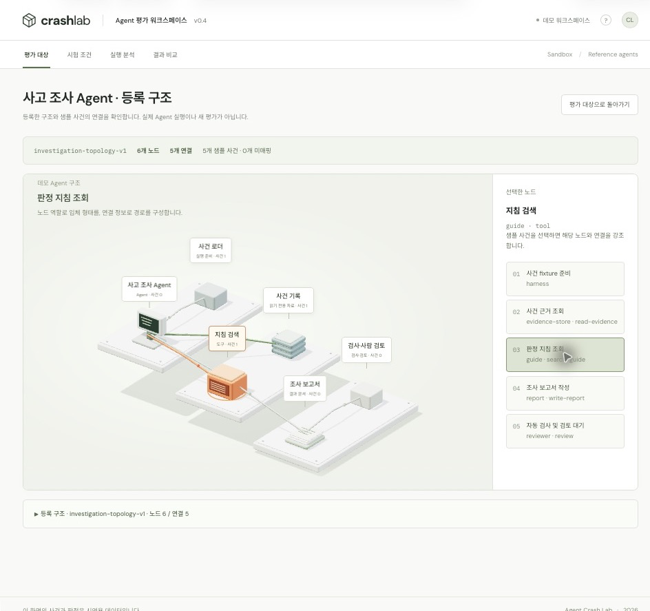

# Agent Crash Lab · Frontend

메인 메뉴 다섯 개는 같은 로그인·시험 조건·실행 ID를 공유하며 MCP 공개 API에 연결합니다. 기존 샘플 화면은 우측 **데모 예시**로 분리했습니다.

| 메뉴 | 실제 기능 |
|---|---|
| 평가 대상 | 서버의 시험 목록으로 구매·사고 조사 Agent와 제공 시험 확인·선택 |
| 시험 조건 | 선택 대상의 시나리오·B0/B1 설정. SYSTEM 외 시험에는 서버 정책을 보내지 않음 |
| 실제 실행 | 실제 실행 생성·상태 조회·승인·거절. 실행 ID는 메뉴 이동 후 유지 |
| 실행 분석 | 선택한 실행의 3D·이벤트 순서·재생·검사 근거·조사 보고서·근거 JSON 다운로드 |
| 결과 비교 | 서버가 저장한 완료 SYSTEM 실행 비교. 주문 수·규칙별 판정·고정/변경 조건 표시 |

## 실행·직접 확인

저장소 루트에서 `.env`를 준비하고 실행합니다. `INTERNAL_API_TOKEN`은 비어 있으면 안 됩니다.

```bash
make dev-harness-up
```

<http://127.0.0.1:5173/#agents>에서 다음 순서로 확인합니다.

1. `requester-01`로 로그인합니다. 비밀번호는 `DEMO_USER_PASSWORD`이며 미지정 시 MCP 기본값을 사용합니다.
2. **평가 대상**에서 구매 Agent를 선택합니다. 실제 서버 목록의 SYSTEM·PA 시험이 표시됩니다. 조사 Agent는 IA 시험을 제공합니다.
3. **시험 조건**에서 `S01`, `B1`을 선택하고 **이 조건으로 실행 준비**를 누릅니다. 조건 설정만으로 실행이 생성되지는 않습니다.
4. **실제 실행**에서 조건을 확인하고 **시험 시작**을 누릅니다. 승인 대기 시 `approver-01`로 승인하거나 거절합니다.
5. **실행 분석**으로 이동해 동일 실행의 최종 주문 수·판정·이벤트·모델을 확인합니다. 재생·슬라이더·노드/이벤트 선택·JSON 내보내기를 사용할 수 있습니다. 승인 대기 중이면 승인 화면으로 돌아갈 수 있습니다.
6. **결과 비교**에서 동일한 SYSTEM 시나리오의 완료된 실행 두 개를 선택합니다. S03/B0의 주문 2건, B1의 주문 1건이 비교 기준입니다. 변경된 조건도 반드시 함께 확인합니다.
7. 대상·조건·선택 실행·조회 이벤트·비교 결과는 메뉴 사이에서 보존됩니다. **데모 예시**를 오갔다가 돌아와도 실제 상태와 섞이지 않습니다.

`COMPLETED`는 실행 종료이며 모든 검사의 PASS를 뜻하지 않습니다. 조사 설명 품질은 자동 구조·출처 검사와 별도로 검토합니다. 모델·프롬프트·제한은 서버에서 고정하고 분석 화면에 기록합니다. 조사 모델 정보는 조사 실행의 실제 metadata를 사용합니다.

실행·기록은 서버에 저장됩니다. 로그인 토큰은 메모리에만 보관하므로 새로고침 시 재로그인 후 실행 기록을 열어야 합니다. 비밀번호·세션은 로컬 저장소에 기록하지 않습니다. 동시에 하나의 실행만 허용하며, 409를 받으면 진행 중인 실행·조사 상태를 확인합니다.

## 연결·실행 모드

```text
Browser /api → Nginx (Node 개발 서버는 /api 프록시) → MCP 공개 API
  로그인·승인: MCP 직접 처리
  시나리오·실행·이벤트·비교: 인증된 사용자 정보로 Harness에 전달
Harness → Agent → MCP 도구 → PostgreSQL
```

- 내부 토큰·사용자 식별 헤더는 MCP가 세션에서 만들며 브라우저 값으로 신뢰하지 않습니다.
- 화면은 JSON을 1초마다 순차 조회합니다. `after_sequence`로 이어받고 중복과 페이지를 처리합니다. `is_final`까지 확인해 조사와 저장 대기 이벤트가 끝난 뒤 멈춥니다. 화면 전송에는 SSE를 사용하지 않습니다.
- 조회 오류는 재접속하지만 실행 생성·승인 쓰기는 자동 재전송하지 않습니다. 승인 전달 실패의 `decision_saved`는 같은 결정을 다시 보내도록 안내합니다.
- 3D와 내보내기는 서버 이벤트를 사용합니다. 관측되지 않은 commit·판정을 생성하지 않습니다. 주문 수는 `observed_order_count`이며 관측 전에는 `—`로 표시합니다.
- 무료 검증은 `AGENT_MODEL_MODE=offline`, 실제 LLM은 `openai`입니다. 도구의 mock/MCP와 모델 모드는 별개입니다. 로컬에서 실제 LLM을 활성화한 상태라면 새 실행에 API 비용이 발생하며 기존 예산 제한을 적용합니다.
- Node 개발 서버는 `MCP_API_URL`(기본 `http://127.0.0.1:8081`)로 프록시합니다. Docker는 서비스 내부 주소를 사용합니다.

## 검증 기록

프론트 자동 테스트 20개: API 오류·토큰 헤더·쓰기 재전송 금지, 이벤트 검증, 대상별 시험 필터와 실제 요청 내용, 실제/데모 경로 분리, 모듈 버전·기존 데모 회귀를 포함합니다.

Chrome에서 메인 메뉴 전체를 이동하며 실제 API 목록·선택 조건 유지·실행 생성·승인·분석을 확인했습니다. `RUN-079`(실제 GPT-5 nano, S01/B1)는 주문 1건, PASS 6 / FAIL 0으로 완료됐으며 이벤트 41건을 JSON으로 내보냈습니다. 저장된 `RUN-069`/`RUN-070` 비교와 조사 실행 `RUN-076`의 보고서 조회도 확인했습니다. 개별 연결 검증이며 모델 품질 평가를 대체하지 않습니다.

아래는 기존 데모 메뉴의 설명과 캡처입니다.


## Agent별 구조를 사용하는 3D (v0.4)

3D는 등록된 **노드·연결·역할**을 바탕으로 생성됩니다. 발주 Agent는 7개 노드·7개 연결, 사고 조사 Agent는 6개 노드·5개 연결로 서로 다른 구조를 사용합니다. 두 Agent 모두 3D와 타임라인을 지원합니다.

**데모 예시 → 데모 평가 대상**의 **Agent 구조 등록**에서 JSON으로 새 프로필·구조·샘플 이벤트를 등록할 수 있습니다. **이 Agent의 구조 · 이벤트 3D 보기**에서 구조와 이벤트 매핑을 확인하세요. 등록 정보는 해당 브라우저에 저장되며 실제 실행 API 연결은 별도입니다.

[구조 등록 필드·동작·검증 설명](docs/topology.md) · [등록용 리서치 Agent 예시](docs/examples/research-agent.json)



## 빠르게 실행하기

Node.js 20 이상이 필요합니다. npm 패키지 설치나 별도 빌드 없이 실행합니다.

```bash
# 저장소 루트에서
cd frontend
npm run dev
```

- 기본 주소: <http://localhost:5173>
- 3D 데모 바로 열기: <http://localhost:5173/#demo-3d>
- 구문 검사: `npm run check`
- 다른 포트 사용(macOS/Linux): `PORT=5174 npm run dev`

`dist/`는 이 프로토타입의 **실제 정적 소스**이며 Git에 포함합니다. Three.js도 로컬 파일로 제공하므로 npm 의존성이 없습니다. `file://`로 열지 말고 HTTP 서버로 실행하세요.

## 데모 메뉴 사용 흐름

**평가 대상 → 데모 데이터 점검 → 시험 조건 → 실행 분석 → 결과 비교**

1. **평가 대상**에서 발주 Agent 또는 사고 조사 Agent를 선택합니다.
2. **데모 데이터 점검하기**로 내장 데이터, 사건 ID·순서, 판정 근거 참조, 버전 정보를 확인합니다. 실제 서버 연결 검사는 아닙니다.
3. **데모 시험 준비**를 눌러 시나리오와 실행 환경을 선택합니다.
4. **데모 시험 불러오기**를 눌러 저장된 실행을 분석합니다. 노드·사건·판정을 선택하면 연결된 근거를 볼 수 있습니다.
5. 발주 Agent는 **결과 비교**에서 같은 시나리오의 B0/B1 예시를 확인합니다. 조사 Agent는 해당 시험의 검사 범위와 검토 대기 항목을 확인합니다.

3D만 먼저 보고 싶다면 첫 화면의 **발주 3D 데모**를 누르세요. 발주 Agent의 S03/B0 예시를 응답 유실 시점에서 엽니다.

## 주요 화면

### 1. 평가할 Agent 선택


- Agent의 역할, 평가 범위, 버전, 프롬프트 버전, 사용 도구를 확인합니다.
- 프로필과 버전은 데모용 참조 값입니다. 실제 모델·버전·판정은 메인 실행 분석에서 확인하며 실제 실행 이동 버튼을 제공합니다.
- **Agent와 실행 환경을 구분**합니다. B0/B1은 Agent 종류가 아니라 업무 서버의 중복 방지 정책입니다.

### 2. 3D 실행 분석과 근거 조회

위 첫 번째 캡처는 발주 Agent의 S03/B0 실행 예시입니다.

- Three.js 기반 고정 시점 3D로 Agent → MCP → 업무 DB의 실행 경로를 표시합니다.
- 발주 저장과 성공 응답 유실을 구분하고, 재생 시점까지 저장된 발주만 표시합니다.
- 노드·사건·검사 항목을 클릭하면 오른쪽에 근거 ID, 선행 사건, 사건 JSON이 열립니다.
- 타임라인 전환, 재생·정지, 속도 변경, 구간 이동, 근거 JSON 복사·내보내기를 제공합니다.
- 최종 검사 결과는 재생 위치와 별도로 표시합니다. 이력 재생은 새 평가로 집계하지 않습니다.

### 3. 구성별 결과 비교


같은 입력과 검사 기준에서 B0/B1의 발주 수와 검사 결과를 비교합니다. S03 예시의 변경 요소는 **서버 중복 방지 정책**입니다. 서버 개선을 Agent 지능 향상으로 해석하지 않습니다.

모든 캡처는 2026-10-19 로컬 브라우저에서 촬영한 데모 화면입니다.

## 무엇을 평가하는 화면인가?

| 평가 대상 | 제공하는 데모 | 확인할 내용 | 분석 화면 |
|---|---|---|---|
| 발주 Agent | S01 정상 발주, S02 승인 거절, S03 저장 후 응답 유실 × B0/B1 | 승인 통제, 승인 내용 일치, 중복 발주 방지, 완료 보고 정합성 | 3D / 타임라인 / B0·B1 비교 |
| 사고 조사 Agent | IA01 중복 발주 근거, IA02 근거 부족, IA03 차단된 무승인 시도 | 근거 ID, 읽기 전용 도구, 사실·원인 후보·부족한 근거 구분 | 3D / 타임라인 / 검사 범위 |

발주 흐름은 **Agent + MCP + 업무 서버를 포함한 시스템 평가**를 시각화합니다. 사고 조사 흐름은 고정 사건 fixture를 이용한 Agent 개별 평가를 시각화합니다. 조사 설명의 의미적 적합성은 자동 PASS로 처리하지 않고 **INCONCLUSIVE · 사람 검토 대기**로 남깁니다.

## 기존 데모 메뉴의 범위

우측 **데모 예시** 안의 `데모 평가 대상`, `데모 시험 조건`, `데모 실행 분석`, `데모 결과 비교`만 내장 예시를 사용합니다. 사용자 등록 구조도 이 데모 영역에서만 사용하며, 메인 메뉴 다섯 개와 실행 상태를 공유하지 않습니다.

## 파일 구조

```text
frontend/
├── dist/                  # 별도 빌드 없이 제공하는 정적 소스
│   ├── index.html         # 앱 셸, 메뉴, 안내 대화상자
│   ├── styles.css         # 화면 및 반응형 스타일
│   ├── live.js            # 실제 로그인·실행·승인·이벤트·검사·조사·비교 화면
│   ├── live-api.js        # 공개 API 호출·이벤트 병합
│   ├── app.js             # 데모 상태, 사건·판정, 렌더링과 상호작용
│   ├── registry.js        # Agent 프로필, 조사 fixture, 로컬 데이터 검증
│   ├── topology.js        # 구조 검증, 자동 배치, 이벤트 매핑
│   ├── topologies.js      # 서로 다른 데모 구조와 등록 예시
│   ├── registration.js    # JSON 등록 화면
│   ├── scene.js           # 등록 구조 기반 3D, 조명·그림자, 사건 강조, 노드 선택
│   └── vendor/            # Three.js 0.180.0 및 MIT 라이선스
├── docs/                  # 캡처, 구조 계약, 등록용 JSON 예시
├── tests/                 # 구조·매핑·등록·실행 상태 회귀 검사
├── server.mjs             # 127.0.0.1에 바인딩하는 로컬 정적 서버 + /api 프록시
├── package.json           # 실행 및 구문 검사 명령
├── Dockerfile             # Nginx 정적 서빙 + /api 프록시
└── README.md
```

## Docker로 프론트엔드만 실행하기

저장소 루트에서 실행합니다. Docker Engine 또는 Docker Desktop이 실행 중이어야 합니다.

```bash
docker build -t agent-crash-lab-frontend ./frontend
docker run --rm -p 127.0.0.1:5173:80 agent-crash-lab-frontend
```

기존 Compose를 사용할 경우 루트의 `.env`를 준비한 뒤 `docker compose -f infra/docker-compose.yml --env-file .env up --build --no-deps frontend`로 프론트엔드만 실행할 수 있습니다. 백엔드 없이도 데모 메뉴를 볼 수 있습니다. 실제 실행 메뉴는 같은 Docker 네트워크의 `mcp-server:8081`에 연결하며, 사용하지 않던 `VITE_API_URL` 빌드 인자는 제거했습니다.

## 검증과 호환성

- `npm run check`: 앱·Agent registry·구조 계약·등록 UI·3D·로컬 서버의 JavaScript 구문 검사.
- `npm test`: 20개 테스트. 공개 API 인증 헤더, 쓰기 자동 재전송 금지, 이벤트 중복 제거·실행 ID 검증·종료 조건과 9개 데모 조합의 매핑, 잘못된 구조 차단, 재생·되감기, 등록 저장·복구, 실행별 구조 고정 검증.
- 로컬 브라우저: Agent 선택·데모 점검·시험 준비·3D·타임라인·비교 화면 확인.
- Docker의 실제 MCP·Harness·Agent를 통한 브라우저 검증 절차는 위의 실제 실행 순서를 따릅니다.
- 3D는 WebGL을 사용합니다. 그래픽 가속을 사용할 수 없는 경우 타임라인을 이용하세요.
- Google Fonts 로딩이 불가능하면 시스템 글꼴로 표시됩니다.
- Three.js 라이선스: [MIT License](dist/vendor/THREE-LICENSE.txt).

브라우저에 남은 이전 JavaScript와 새 HTML이 섞이지 않도록 정적 소스는 `Cache-Control: no-store`로 제공하고, 진입 스크립트·스타일·내부 모듈에 동일한 릴리스 버전을 붙입니다. v0.5에서 기존 Chrome 탭의 ‘실제 실행’이 데모 빈 화면으로 잘못 렌더링되던 문제를 재현하고 로그인·실행 기록 표시까지 확인했습니다.

### 실제 실행 화면의 안내

평가 대상 → 시험 조건 → 실제 실행 → 실행 분석 순서로 진행합니다. 조건 설정만으로 실행하지 않으며, **시험 시작**을 누르면 접수 번호와 진행 상태를 표시합니다. 진행 중에는 새 시작 폼을 숨기고, 승인 대기에는 **승인 요청 확인**, 종료 후에는 **결과 확인**을 안내합니다. 실행 분석의 **검사 결과·보고서로 이동**으로 3D 아래의 결과를 바로 확인할 수 있습니다. 새 실행은 **새 시험 준비**에서 조건을 다시 확인한 뒤 시작합니다.

상태 안내는 서버 상태에 따릅니다. 실행 종료를 검사 통과로 표현하지 않으며, 보고서를 생성하지 않는 시험에서는 보고서를 기다리도록 안내하지 않습니다.
