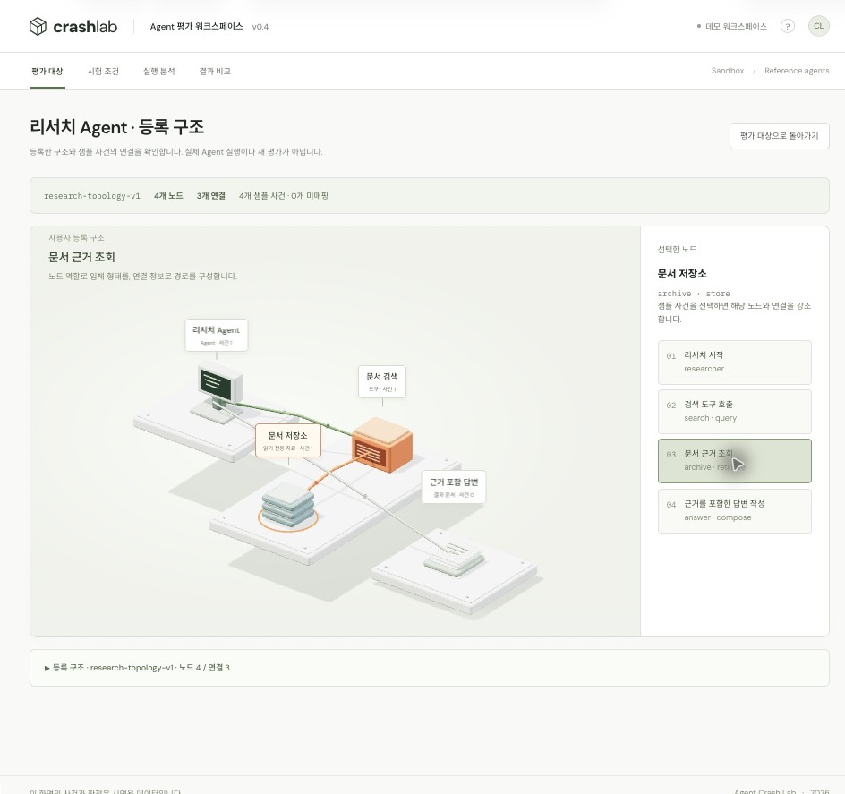

# Agent 구조 등록 계약 · v0.4

3D는 Agent 이름에 맞춘 고정 장면이 아니라 등록된 `topology`를 렌더링합니다. 이 계약은 **관측 범위를 설명하는 선언적 구조**입니다. Agent 내부 추론을 자동으로 발견하거나 실제 시스템 연결을 증명하지 않습니다.

## 등록하기

1. 평가 대상 화면에서 **Agent 구조 등록**을 엽니다.
2. JSON에 Agent의 `id`, `name`, `version`, `topology`, 선택적인 `events`를 입력합니다.
3. **구조와 이벤트 점검**으로 노드·연결·이벤트 참조를 검증합니다.
4. **등록하고 3D 보기**를 누르면 해당 브라우저에 저장하고 3D를 엽니다.

바로 사용할 수 있는 예시: [리서치 Agent JSON](examples/research-agent.json). 등록 창의 **리서치 Agent 예시 채우기**도 같은 데이터를 사용합니다.

기존 id는 덮어쓰지 않습니다. 변형 구조를 비교하려면 새 id와 구조 버전을 사용하세요. 최대 20개 사용자 구조를 저장합니다. 로컬 저장소를 사용할 수 없으면 현재 세션에서만 사용할 수 있으며 화면에 안내합니다. 다른 브라우저·다른 사이트 주소로 자동 동기화되지는 않습니다.

## 필드

| 경로 | 의미 |
|---|---|
| `id`, `name`, `version` | Agent 식별자, 표시 이름, 참조 버전 |
| `topology.version` | 구조 버전. 실행 이력에는 이 버전과 구조 전체를 보존 |
| `topology.nodes[].id` | 구조 안에서 고유한 노드 ID |
| `topology.nodes[].label` | 화면에 표시할 이름 |
| `topology.nodes[].role` | 노드의 역할 및 3D 형태 |
| `topology.nodes[].layer` | 0~5 단계. 작은 값부터 계층을 배치 |
| `topology.nodes[].lane` | 선택 값, -4~4 정수. 같은 계층 내 배치 순서; 생략하면 자동 배치 |
| `topology.edges[].id` | 고유한 연결 ID |
| `topology.edges[].source`, `target` | 시작·도착 노드 ID; 방향 화살표에 사용 |
| `topology.edges[].label` | 연결의 의미 |
| `events[].event_id`, `sequence` | 고유 사건 ID와 1부터 연속되는 순서 |
| `events[].node_id` | 사건이 발생한 노드 |
| `events[].edge_id` | 선택 값. 실제로 관측한 연결; 해당 노드는 연결의 끝점이어야 함 |
| `events[].type`, `title`, `payload` | 사건 종류, 제목, 선택적인 원본 데이터 |

노드는 1~16개, 연결은 최대 32개, 샘플 사건은 최대 200개, 입력은 100 KB 이하입니다. ID는 영문자로 시작하며 영문·숫자·`_`·`-`를 사용합니다. 중복 ID, 없는 끝점, 자기 자신을 향하는 연결, 같은 명시적 layer/lane 중복, 잘못된 역할과 이벤트 매핑은 등록을 거부합니다. 되돌아가는 연결은 허용합니다. 배치는 연결 순서를 추론하지 않고 명시된 계층을 사용합니다.

| role | 표시 형태 / 용도 |
|---|---|
| `agent` | 모니터 · Agent |
| `runner` | 실행 준비 장치 |
| `approval` | 승인 버튼 |
| `tool` | 주황색 도구 게이트웨이 |
| `database` | 원통형 업무 DB |
| `store` | 적층된 읽기 전용 자료 |
| `report` | 보고서 문서 |
| `reviewer` | 검사·사람 검토 장치 |

`events: []`로 구조만 등록할 수도 있습니다. 샘플 이벤트를 넣어도 새 평가나 PASS/FAIL을 생성하지 않습니다. 입력한 JSON을 코드로 실행하거나 외부 URL로 요청하지 않습니다. 비밀키와 개인정보는 입력하지 마세요.

## 이벤트와 3D의 관계

- **회색 연결:** 등록되었지만 현재 재생 시점까지 연결 이벤트가 관측되지 않음.
- **녹색 연결:** 현재 재생 시점까지 `edge_id`로 관측된 연결.
- **주황색 연결·노드 테두리:** 선택한 사건의 연결과 노드.
- 노드의 사건 수와 DB 저장 건수는 현재 재생 시점까지의 사건으로 계산합니다. 되감으면 함께 줄어듭니다.
- 연결 ID가 없는 사건은 노드만 강조합니다. 연속된 두 사건을 임의의 연결로 이어 붙이지 않습니다.
- 등록되지 않은 노드·연결의 이벤트는 미매핑으로 표시하며 임의의 노드로 대체하지 않습니다. 신규 등록 단계에서는 이러한 샘플을 거부합니다.
- 실행을 불러올 때 구조를 복제해 고정합니다. 다른 Agent를 준비하거나 미리봐도 이미 불러온 실행의 구조는 바뀌지 않습니다.
- 근거 JSON 내보내기에는 구조 전체·구조 버전과 각 이벤트의 `node_id`·`edge_id`가 포함됩니다.

## 서로 다른 구조 검증

| 대상 | 노드 / 연결 / 계층 | 구성 |
|---|---|---|
| 발주 Agent | 7 / 7 / 4 | 실행 준비·Agent → 승인·업무 도구 → DB·Oracle → 사고 조사 |
| 사고 조사 Agent | 6 / 5 / 3 | 사건 로더·Agent → 사건 기록·지침 검색 → 보고서·검토 |
| 등록 예시 리서치 Agent | 4 / 3 / 3 | 리서치 Agent → 검색·문서 저장소 → 근거 포함 답변 |

조사 Agent에 발주 DB나 승인 노드를 표시하지 않습니다. 조사 결과의 설명 적합성은 기존과 같이 사람 검토 대기로 남깁니다.

`npm test`는 9개 데모 조합의 이벤트 매핑, 다른 구조의 배치, 재생·되감기, 잘못된 참조 차단, 등록 저장·복구, 실행 구조 고정과 표시 문자열 이스케이프를 검사합니다. 로컬 Safari에서도 발주/조사 구조 전환, 조사 실행의 3D 표시, 리서치 구조 등록·이벤트 선택·새로고침 복구, 잘못된 연결 등록 거부를 확인했습니다. 실제 Agent/API 연동 검증을 의미하지 않습니다.

## 실제 실행 API 연동 시

백엔드에서 Agent 프로필과 구조 버전을 제공하고, 실행 생성 시 해당 구조를 고정해 저장해야 합니다. 수신 이벤트에 그 구조의 `node_id`와 관측된 경우에만 `edge_id`를 담아 같은 렌더러에 전달할 수 있습니다. SSE 수신·인증·승인·영구 실행 저장은 아직 구현하지 않았습니다.
